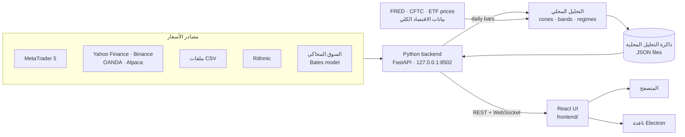

<div align="center">


# Quantum Terminal

<p dir="rtl"><strong>منصة تداول مجانية ومفتوحة المصدر ترسم النماذج الاحتمالية —<br/>الـ volatility cones والـ bands ومستويات الخيارات — فوق الشارت الحي مباشرة.</strong></p>

[English](README.md) · **العربية**

[](https://github.com/wJubran/QuantumTerminal/releases/latest)
[](https://github.com/wJubran/QuantumTerminal/actions/workflows/ci.yml)
[](LICENSE)


<sub dir="rtl">المنصة هنا تعمل على السوق المحاكى المدمج، والـ cones الأسبوعية تحسبها المنصة بنفسها — بدون أي حساب لدى وسيط.</sub>

</div>

---

<div dir="rtl">

## لماذا Quantum Terminal؟

معظم منصات الأفراد مبنية حول مؤشرات متأخرة مثل RSI وMACD. أما Quantum Terminal فيعرض
**المدى الذي يُرجَّح إحصائياً أن يتحرك فيه السعر**: نطاقات توقّع (forecast cones) من نماذج GBM
وMerton jump-diffusion ‏(MJD) وBates، ونطاقات الـ volatility، ومستويات سوق الخيارات (gamma exposure
وجدران call/put والـ max pain)، مرسومة مباشرة فوق الشموع الحية.

وهي **منصة عرض** محلية وسريعة: الحسابات الثقيلة تُجهَّز مسبقاً، فيبقى التطبيق نفسه خفيفاً —
شارت حي وإدخال أوامر وإدارة صفقات، وكل ذلك على جهازك أنت.

## ابدأ بسرعة

إذا كان لديك **Python 3.10** أو أحدث، فأربعة أوامر تكفي. السوق المحاكى يعمل على Windows وmacOS وLinux:

</div>

```bash
git clone https://github.com/wJubran/QuantumTerminal.git
cd QuantumTerminal/backend
pip install -r requirements.txt
python launcher.py --sim
```

<div dir="rtl">

تُفتح المنصة في متصفحك على العنوان **http://127.0.0.1:8502**. لا تسجيل حساب، ولا مفتاح ترخيص، ولا
اشتراك مدفوع. ولأسعار حية بدون وسيط، شغّلها بالأمر <code dir="ltr">python launcher.py --provider yahoo</code>
(العملات والمعادن والطاقة والحبوب والمؤشرات والعملات الرقمية) أو بالخيار <code dir="ltr">--provider binance</code>
(العملات الرقمية)، والتفاصيل في [مصادر البيانات](#مصادر-البيانات). هل أنت جديد على Python، أو تريد
MetaTrader 5؟ اتبع [الدليل خطوة بخطوة](#التثبيت-والتشغيل-خطوة-بخطوة) أدناه.

## المتطلبات

| | المطلوب | ملاحظات |
|---|---|---|
| **نظام التشغيل** | Windows 10 أو 11، أو macOS، أو Linux بنظام 64 بت | MetaTrader 5 يحتاج Windows، أما السوق المحاكى فيعمل على الأنظمة الثلاثة |
| **Python** | الإصدار 3.10 أو أحدث، بنسخة 64 بت | جُرّبت المنصة على 3.10 و3.12 و3.13. على Windows فعّل خيار <code dir="ltr">Add python.exe to PATH</code> أثناء التثبيت |
| **الذاكرة** | ذاكرة بسعة 4 غيغابايت | الـ backend نفسه يستهلك نحو 150 ميغابايت |
| **مساحة القرص** | نحو 1 غيغابايت فارغة | حزم Python تأخذ نحو 500 ميغابايت |
| **المتصفح** | نسخة حديثة من Chrome أو Edge أو Firefox أو Safari | أو استخدم تطبيق سطح المكتب بدلاً منه |
| **الإنترنت** | للتثبيت، ثم لمصادر البيانات الحية وبيانات الاقتصاد الكلي (FRED وCFTC وYahoo Finance) والتحقق من التحديثات | السوق المحاكى وملفات CSV تعمل دون إنترنت |
| **MetaTrader 5** ‏(اختياري) | منصة MT5 من وسيطك، مع تسجيل الدخول إلى حساب (الحساب التجريبي يكفي) | على Windows فقط، وهي إحدى طرق الحصول على أسعار حقيقية وإرسال أوامر حية، والطرق الأخرى في [مصادر البيانات](#مصادر-البيانات) |
| **Node.js** ‏(اختياري) | الإصدار 20 أو أحدث | فقط لتطبيق سطح المكتب أو لإعادة بناء الواجهة |
| **Git** ‏(اختياري) | أي إصدار | أو حمّل الكود كملف ZIP |

## التثبيت والتشغيل خطوة بخطوة

### 1. ثبّت Python

- **على Windows:** حمّل مثبّت نسخة 64 بت من [python.org](https://www.python.org/downloads/windows/)،
  وفعّل خيار **Add python.exe to PATH** في الشاشة الأولى. ثم افتح نافذة *Command Prompt* جديدة وتأكد أن
  الأمر <code dir="ltr">python --version</code> يُظهر 3.10 أو أحدث.
- **على macOS:** استخدم المثبّت من [python.org](https://www.python.org/downloads/macos/) أو الأمر
  <code dir="ltr">brew install python@3.12</code>. وعلى macOS وLinux اكتب <code dir="ltr">python3</code>
  أينما ذُكر <code dir="ltr">python</code> في هذا الدليل.
- **على Linux:** ثبّت حزم توزيعتك، فعلى Debian وUbuntu مثلاً نفّذ الأمر
  <code dir="ltr">sudo apt install python3 python3-venv python3-pip</code> في نافذة الأوامر.

### 2. احصل على الكود

</div>

```bash
git clone https://github.com/wJubran/QuantumTerminal.git
cd QuantumTerminal
```

<div dir="rtl">

بدون Git: من صفحة المستودع اضغط **Code ← Download ZIP**، وفُكّ الضغط، ثم افتح نافذة الأوامر داخل المجلد
الناتج، وقد يكون اسمه <code dir="ltr">QuantumTerminal-main</code> بعد فك الضغط.

### 3. أنشئ بيئة افتراضية (مُستحسن)

البيئة الافتراضية (virtual environment) تعزل حزم المنصة عن بقية النظام. أنشئها داخل مجلد المشروع، فهناك
يبحث عنها تطبيق سطح المكتب أيضاً:

</div>

```bat
:: Windows (Command Prompt)
python -m venv .venv
.venv\Scripts\activate
```

```bash
# macOS / Linux
python3 -m venv .venv
source .venv/bin/activate
```

<div dir="rtl">

سيبدأ سطر الأوامر الآن بـ <code dir="ltr">(.venv)</code>. فعّل البيئة من جديد في كل نافذة أوامر جديدة قبل
تشغيل المنصة. وإذا رفض PowerShell تشغيل سكربت التفعيل، فنفّذ مرة واحدة الأمر
<code dir="ltr">Set-ExecutionPolicy -Scope CurrentUser RemoteSigned</code>، أو استخدم نافذة Command Prompt بدلاً منه.

### 4. ثبّت المكتبات المطلوبة

</div>

```bash
cd backend
pip install -r requirements.txt
```

<div dir="rtl">

يستغرق التثبيت الأول بضع دقائق. حزمة <code dir="ltr">MetaTrader5</code> تُثبَّت على Windows فقط، لأن
شركة MetaQuotes لا تنشرها إلا لنظام Windows وحده.

### 5. شغّل المنصة

**على السوق المحاكى** (أي نظام، دون حساب لدى وسيط):

</div>

```bash
python launcher.py --sim
```

<div dir="rtl">

**على أسعار حية، بدون وسيط** (أي نظام، ويكفي الاتصال بالإنترنت):

</div>

```bash
python launcher.py --provider yahoo      # forex, metals, energy, grains, indices, crypto
python launcher.py --provider binance    # crypto, in real time
```

<div dir="rtl">

بعدها تذهب الأوامر إلى حساب ورقي ينفّذها بتلك الأسعار الحية. أما OANDA وAlpaca وملفات CSV فتُعدّ من
*الإعدادات ⚙ ← DATA SOURCES*، والتفاصيل في [مصادر البيانات](#مصادر-البيانات).

**مع MetaTrader 5** (على Windows):

1. ثبّت MetaTrader 5 من وسيطك وسجّل الدخول إلى حسابك (الحساب التجريبي يكفي).
2. لتتمكن من إرسال الأوامر من Quantum Terminal، فعّل **Algo Trading** في MetaTrader 5 من زره في شريط الأدوات،
   أو من القائمة <code dir="ltr">Tools → Options → Expert Advisors</code> بتفعيل الخيار
   <code dir="ltr">Allow algorithmic trading</code> فيها.
3. اترك MetaTrader 5 مفتوحاً وشغّل الأمر: <code dir="ltr">python launcher.py</code>
4. إذا لم تعثر المنصة على MetaTrader 5 تلقائياً، فاضبطه من *الإعدادات ⚙ ← PROVIDERS*: إما
   **TERMINAL PATH** (مسار الملف <code dir="ltr">terminal64.exe</code>) أو **LOGIN CREDENTIALS** (السيرفر ورقم
   الحساب وكلمة المرور).

يطبع المشغّل عنوان السيرفر وأماكن ملف الإعدادات والبيانات (<code dir="ltr">AppData:</code>) وملف السجل،
ثم يفتح العنوان **http://127.0.0.1:8502** في متصفحك. إذا لم يُفتح المتصفح فافتح العنوان بنفسك. واترك نافذة
المشغّل مفتوحة طوال استخدامك للمنصة.

### 6. أول خطوات داخل المنصة

- **الـ cones:** على الشارت افتح السهم ▾ بجانب **CONES** واختر DAILY أو WEEKLY أو MONTHLY أو QUARTERLY،
  ومنه أيضاً **BATES** لعرض نموذج Bates. في المرة الأولى تكون جاهزة بعد التشغيل بنحو 30 ثانية.
- **التداول:** الأوامر محظورة إلى أن تفعّل *الإعدادات ⚙ ← TRADING ← LIVE TRADING*. وفي المحاكي، وفي
  المصادر التي تقدّم الأسعار فقط، يفتح هذا المفتاح الحساب الورقي فقط (100,000 دولار برافعة 1:100).
- **مصدر البيانات:** من *الإعدادات ⚙ ← DATA SOURCES* تنتقل بين MetaTrader 5 وYahoo Finance وBinance وOANDA
  وAlpaca وملفات CSV والمحاكي أثناء عمل المنصة، وتتذكر المنصة اختيارك.
- **مركز التعلم:** تبويب **LEARN** يشرح كل صفحة وكل نموذج، بالعربية والإنجليزية.

### 7. الإيقاف وإعادة التشغيل والتحديث

- **الإيقاف:** اضغط <code dir="ltr">Ctrl+C</code> في نافذة المشغّل، أو أغلقها.
- **إعادة التشغيل:** افتح نافذة أوامر داخل مجلد المشروع، وفعّل البيئة الافتراضية (الخطوة 3)، ثم نفّذ
  <code dir="ltr">cd backend</code> و<code dir="ltr">python launcher.py</code> (وأضف
  <code dir="ltr">--sim</code> للسوق المحاكى).
- **التحديث:** داخل مجلد المشروع نفّذ <code dir="ltr">git pull</code>، ثم
  <code dir="ltr">pip install -r backend/requirements.txt</code> والبيئة الافتراضية مفعّلة. تبقى إعداداتك
  والحساب الورقي كما هي، لأنها محفوظة في مجلد <code dir="ltr">AppData:</code> لا في مجلد المشروع.
- **إزالة المنصة:** احذف مجلد المشروع ومجلد <code dir="ltr">AppData:</code> الذي يظهر عند التشغيل.

### تطبيق سطح المكتب (اختياري)

بعد تثبيت Node.js بالإصدار 20 أو أحدث:

</div>

```bash
cd electron_shell
npm install
npm start              # or: npm run start:sim
```

<div dir="rtl">

يشغّل التطبيق الـ backend تلقائياً، مستخدماً البيئة <code dir="ltr">.venv</code> أو
<code dir="ltr">venv</code> في مجلد المشروع إن وُجدت، وإلا فـ Python المثبّت على الجهاز، ويعرض المنصة في
نافذة مستقلة. ويحفظ إعداداته في مجلد خاص به اسمه <code dir="ltr">QuantumTerminal-v2</code>، منفصل عن إعدادات نسخة المتصفح.

### حل المشكلات الشائعة

| المشكلة | الحل |
|---|---|
| رسالة <code dir="ltr">'python' is not recognized</code> على Windows | شغّل مثبّت Python مجدداً وفعّل <code dir="ltr">Add python.exe to PATH</code>، أو اكتب <code dir="ltr">py</code> بدلاً من <code dir="ltr">python</code> |
| رسالة <code dir="ltr">error while attempting to bind on address</code> | المنفذ 8502 مستخدم، غالباً بنسخة أخرى من المنصة. أغلقها، أو شغّل المنصة على منفذ آخر بإضافة <code dir="ltr">--port 8600</code> إلى الأمر |
| لا توجد حزمة <code dir="ltr">MetaTrader5</code> على macOS أو Linux | هذا متوقع، فهي متوفرة لنظام Windows فقط. استخدم الخيار <code dir="ltr">--sim</code> بدلاً منها |
| رسالة <code dir="ltr">MT5 initialize() failed</code> في السجل | تأكد أن MetaTrader 5 مفتوح ومسجَّل الدخول، واضبط TERMINAL PATH من *الإعدادات ⚙ ← PROVIDERS* |
| MetaTrader 5 يرفض الأوامر لأن التداول الآلي معطّل | فعّل **Algo Trading** في MetaTrader 5 |
| لم يُفتح المتصفح، أو بقيت الصفحة فارغة | افتح http://127.0.0.1:8502 بنفسك، وراجع ملف السجل الذي طبعه المشغّل |
| لا تظهر الـ cones على الشارت | انتظر نحو 30 ثانية بعد التشغيل الأول، ثم فعّلها من السهم ▾ بجانب **CONES** |
| رمز يبقى فارغاً على Yahoo Finance أو OANDA أو Binance أو Alpaca | المصدر يعرفه باسم آخر: اضبط له broker symbol من *الإعدادات ⚙ ← UNIVERSE* (راجع [أسماء الرموز](#أسماء-الرموز)) |
| زر **TEST** في DATA SOURCES يُظهر الخطأ 401 أو 403 | الـ token أو المفتاح خاطئ أو منتهي الصلاحية، أو أنك تستخدم token من practice على live (أو العكس) |
| زر **TEST** لا يصل إلى المصدر | اسمح بعنوانه في جدار الحماية أو الـ proxy: <code dir="ltr">query1.finance.yahoo.com</code> أو <code dir="ltr">api.binance.com</code> أو <code dir="ltr">api-fxpractice.oanda.com</code> (و<code dir="ltr">api-fxtrade.oanda.com</code> للحساب الحقيقي) أو <code dir="ltr">data.alpaca.markets</code> |

## المزايا

### تعمل مباشرة بعد التثبيت

| المجال | ما تحصل عليه |
|---|---|
| **الـ Volatility cones** | الـ cones اليومية والأسبوعية والشهرية والفصلية بنماذج GBM وMJD وBates، تحسبها المنصة من الشموع اليومية لمصدر البيانات نفسه ([كيف](#كيف-تحسب-المنصة-الـ-cones)) |
| **الـ bands الاحتمالية** | نطاقات GBM وMJD وBates تبدأ من جديد عند افتتاح كل يوم تداول، ويُحسب اتساعها من آخر 60 يوم تداول، مع توقّع لـ 20 يوم تداول قادمة ([كيف](#كيف-تحسب-المنصة-الـ-bands)) |
| **إعادة العرض (Replay)** | تعيد عرض الـ cones الأسبوعية والشهرية والفصلية السابقة والـ bands اليومية أمام حركة السعر، شمعة بشمعة |
| **Pulse Room** | ماسح يرتّب قائمة المتابعة حسب موقع السعر داخل الـ cones والـ bands |
| **الـ Regimes** | حالة التقلب لكل أداة (من calm إلى stressed) بنموذج HMM يُدرَّب بأسلوب walk-forward، وتنبيه للتقلب على شموع 15 دقيقة، وربع النمو والتضخم للاقتصاد الكلي من بيانات FRED ([كيف](#كيف-تحسب-المنصة-الـ-regimes)) |
| **صفحة Fundamental** | لوحة الاقتصاد الكلي من بيانات عامة: ربع الـ regime، وصافي سيولة الفيدرالي، ومنحنى العوائد، ومؤشر VIX، ومراكز المضاربين في العقود الآجلة (CFTC)، ودرجة لكل أداة ([كيف](#كيف-تُبنى-صفحة-fundamental)) |
| **صفحة Money Flow** | دوران الأموال بين فئات الأصول والقطاعات الأمريكية والدول، من أسعار صناديق ETF وأحجام تداولها ([كيف](#كيف-تُبنى-صفحة-money-flow)) |
| **شارت حي** | مكتبة TradingView Lightweight Charts من M1 إلى D1، وعدة شارتات في تبويبات، وأدوات رسم، وقوالب للشارت، وقراءة السعر والوقت بالـ crosshair، وساعة عالمية مع جلسات التداول |
| **إدخال الأوامر** | أوامر market وlimit وstop مع stop loss وtake profit، ومعاينة فورية للمخاطرة والعائد بالمبلغ وبالنسبة من الرصيد |
| **الصفقات** | الصفقات المفتوحة مع المخاطرة والعائد والربح/الخسارة؛ اسحب خطوط SL/TP على الشارت، أو عدّل وأغلق من الجدول؛ وشريط يعرض تعرّض الحساب |
| **مصادر البيانات** | MetaTrader 5 وYahoo Finance وBinance وOANDA وAlpaca وملفات CSV، وبيانات Rithmic للعقود الآجلة (تحتاج الحزمة الاختيارية async_rithmic)، مع التبديل بينها أثناء عمل المنصة ([التفاصيل](#مصادر-البيانات)) |
| **التداول الورقي على أسعار حية** | تدرّب على أي مصدر بيانات: حساب ورقي ينفّذ أوامرك بأسعار bid وask الحية لذلك المصدر، مع SL/TP تُنفَّذ عند لمس ذيل الشمعة |
| **السوق المحاكى** | أسعار من نموذج Bates ‏(stochastic volatility + jumps) بإيقاع يومي واقعي، متسقة بين الأُطر الزمنية وقابلة للتكرار من الـ seed نفسه؛ وحساب ورقي مع فحص الهامش، وأوامر SL/TP تُنفَّذ عند لمس ذيل الشمعة (wick) |
| **مركز التعلم** | دليل ثنائي اللغة (العربية / English) للمنصة وللنماذج الكمية (GBM وMJD وBates وGEX) ولأنواع الصفقات واختصارات لوحة المفاتيح |
| **تطبيق سطح المكتب** | غلاف Electron اختياري يشغّل الـ backend ويعرض المنصة في نافذة مستقلة |
| **الأمان** | مفتاح التداول مُطفأ افتراضياً ويفرضه السيرفر أيضاً، والسيرفر محلي فقط، مع حماية من الطلبات القادمة من مواقع أخرى ومن هجمات DNS rebinding، ومفاتيح الـ API لا تعود أبداً إلى المتصفح |

### مستويات الخيارات — من سلاسل الخيارات العامة

| اللوحة | ما تعرضه |
|---|---|
| **Options Quant** | الـ gamma exposure ‏(GEX) ونقطة الـ flip وجدران call/put والـ max pain والحركة المتوقعة والـ IV skew وسيناريوهات الـ dealers وسلالم المستويات |
| **Options Cockpit** | لوحة الخيارات في Stress Lab |

تحسب المنصة هذه اللوحات بنفسها للأدوات US500 وUSTEC وXAUUSD وXAGUSD وXTIUSD من سلاسل خيارات SPY وQQQ
وGLD وSLV وUSO (التفاصيل في [كيف تُبنى صفحة Options Quant](#كيف-تبنى-صفحة-options-quant)). وتبقى ثلاثة
أجزاء تحتاج بيانات لا ينتجها المستودع بعد: سطح الخريطة الحرارية (Heat Map)، وبطاقة Retail Trap، وبطاقة Vanna/Charm.

## مصادر البيانات

يمكن أن تأتي الأسعار من سبعة مصادر. اختر المصدر من *الإعدادات ⚙ ← DATA SOURCES* أثناء عمل المنصة
(بالأزرار **SETTINGS** و**TEST** و**USE**)، أو شغّل المنصة بالأمر
<code dir="ltr">python launcher.py --provider &lt;type&gt;</code>. يستقبل MetaTrader 5 وOANDA أوامرك أيضاً،
أما بقية المصادر فتقدّم الأسعار فقط، لذلك تُنفَّذ أوامرها على **الحساب الورقي** (paper account) بأسعار bid
وask الحية لذلك المصدر.

| المصدر | <code dir="ltr">--provider</code> | الأسواق | الأسعار | المطلوب | تذهب الأوامر إلى |
|---|---|---|---|---|---|
| **MetaTrader 5** | <code dir="ltr">mt5</code> | كل ما يقدّمه وسيطك | لحظية | Windows ومنصة MT5 وحساب لدى وسيط (الحساب التجريبي يكفي) | MT5 |
| **OANDA** | <code dir="ltr">oanda</code> | العملات؛ والذهب والفضة والبلاتين والنفط والغاز الطبيعي والنحاس والذرة والقمح وفول الصويا والسكر؛ ومؤشرات CFD | لحظية | حساب practice مجاني و API token | OANDA |
| **Yahoo Finance** | <code dir="ltr">yahoo</code> | العملات؛ وعقود futures للمعادن والطاقة والحبوب والسلع الطرية والمواشي؛ والمؤشرات والأسهم وصناديق ETF والعملات الرقمية | متأخرة في بعض الأسواق (نحو 10 دقائق للـ futures) | لا شيء: مجاني وبدون حساب | الحساب الورقي |
| **Binance** | <code dir="ltr">binance</code> | العملات الرقمية | لحظية | لا شيء: مجاني وبدون حساب | الحساب الورقي |
| **Alpaca** | <code dir="ltr">alpaca</code> | الأسهم وصناديق ETF الأمريكية (ومنها GLD وSLV وUSO وUNG وCPER)، والعملات الرقمية | لحظية (IEX) | حساب مجاني و API key | الحساب الورقي |
| **ملفات CSV** | <code dir="ltr">csv</code> | أي أداة تملك شموعها | من الملفات | ملفات في مجلد | الحساب الورقي |
| **السوق المحاكى** | <code dir="ltr">sim</code> | الرموز الافتراضية بأسعار اصطناعية | مولَّدة | لا شيء، ويعمل دون إنترنت | الحساب الورقي للمحاكي |

عند التبديل تُعاد تحميل الشارتات، وتُبنى الـ cones والـ bands من جديد من الشموع اليومية للمصدر الجديد خلال
دقيقة أو دقيقتين. ويظهر المصدر النشط في أعلى المنصة: <code dir="ltr">MT5 ● LINKED</code> أو
<code dir="ltr">FEED ● YAHOO</code> أو <code dir="ltr">FEED ● BINANCE</code> وهكذا.

### إعداد كل مصدر

**Yahoo Finance:** لا يحتاج أي إعداد، وتتحدث أسعاره كل 30 ثانية (*Quote refresh*)، ويمكن تقليل المدة مع خطر
تجاوز حدود الطلبات لدى Yahoo. والسعر فيه هو سعر آخر صفقة، لذلك تُنفَّذ أوامر الحساب الورقي عليه دون spread.
المعادن والطاقة والمؤشرات الأمريكية تُعرض كعقود futures الأقرب (الذهب هو <code dir="ltr">GC=F</code>)، لذلك
تختلف مستوياتها قليلاً عن أسعار spot أو CFD. والتاريخ المتاح نحو 7 أيام لشموع الدقيقة، و60 يوماً لشموع 5 إلى
30 دقيقة، وسنتان لشموع الساعة، وعقود من الشموع اليومية.

**Binance:** لا يحتاج أي إعداد. يُقرأ <code dir="ltr">BTCUSD</code> على أنه <code dir="ltr">BTCUSDT</code>،
ويمكنك تغيير *Quote asset* إلى USDC أو FDUSD. وإذا لم يكن <code dir="ltr">api.binance.com</code> متاحاً في
بلدك، كما في الولايات المتحدة، فاختر في *API address* العنوان <code dir="ltr">https://api.binance.us</code>
أو عنوان بيانات السوق فقط <code dir="ltr">https://data-api.binance.vision</code>.

**OANDA:**

1. افتح حساباً تجريبياً (practice) مجانياً في [oanda.com](https://www.oanda.com).
2. من لوحة OANDA افتح *My Account ← Manage API Access* وأنشئ token.
3. من *الإعدادات ⚙ ← DATA SOURCES ← OANDA ← SETTINGS* اختر البيئة <code dir="ltr">practice</code>، والصق
   الـ token، واترك *Account ID* فارغاً لاستخدام حسابك الأول. ثم اضغط **SAVE** ثم **TEST** ثم **USE**.

بعدها تذهب الأوامر إلى حساب OANDA نفسه بمجرد تفعيل LIVE TRADING. والشموع اليومية تبدأ عند إغلاق نيويورك
الساعة 17:00، كما عند وسطاء الفوركس على MetaTrader 5.

**Alpaca:**

1. أنشئ حساباً مجانياً في [alpaca.markets](https://alpaca.markets)، ويكفي حساب paper فقط.
2. من لوحة التحكم أنشئ API key، وانسخ الـ key ID والـ secret. الـ secret يظهر مرة واحدة فقط.
3. الصقهما في *الإعدادات ⚙ ← DATA SOURCES ← Alpaca ← SETTINGS*. الـ *Feed* المسمّى
   <code dir="ltr">iex</code> مجاني، أما <code dir="ltr">sip</code> فيغطي كل البورصات الأمريكية ويحتاج
   اشتراكاً مدفوعاً. ثم اضغط **SAVE** ثم **TEST** ثم **USE**.

**ملفات CSV:** ضع الملفات في مجلد CSV، وهو افتراضياً المجلد <code dir="ltr">csv</code> داخل مجلد
<code dir="ltr">AppData:</code>، وسمّها مثل <code dir="ltr">XAUUSD_M15.csv</code> و<code dir="ltr">XAUUSD_D1.csv</code>
أو <code dir="ltr">XAUUSD.csv</code> فقط. وتُعرف الأعمدة من أسمائها:

- <code dir="ltr">date</code> و<code dir="ltr">time</code>، في عمود واحد أو عمودين؛
- <code dir="ltr">open</code> و<code dir="ltr">high</code> و<code dir="ltr">low</code> و<code dir="ltr">close</code>؛
- <code dir="ltr">volume</code>، وهو اختياري.

تُكتشف الفاصلة والفاصلة المنقوطة والـ tab، ومعظم صيغ التاريخ وUnix time، لذلك تعمل ملفات التصدير من
MetaTrader 5 أو TradingView أو NinjaTrader كما هي. والإطار الزمني غير الموجود يُبنى من إطار أقصر منه
(شموع H1 من M15 مثلاً).
ولحساب الـ cones والـ bands وفّر شموعاً يومية لسنة تقريباً على الأقل، ويجب أن يكون الرمز موجوداً أيضاً
في قائمة UNIVERSE.

**المفاتيح بدون لوحة الإعدادات:** تقرأ المنصة أيضاً متغيرات البيئة <code dir="ltr">OANDA_TOKEN</code>
و<code dir="ltr">OANDA_ACCOUNT_ID</code> و<code dir="ltr">APCA_API_KEY_ID</code>
و<code dir="ltr">APCA_API_SECRET_KEY</code>. وتبقى المفاتيح على جهازك، في الملف
<code dir="ltr">user_config.json</code> داخل مجلد <code dir="ltr">AppData:</code>، ولا تُرسَل إلا إلى API
المصدر نفسه، وتعرضها لوحة الإعدادات بالشكل ••••••.

### أسماء الرموز

تستخدم المنصة اسماً واحداً لكل أداة، وكل مصدر يترجمه إلى اسمه الخاص:

| في المنصة | Yahoo Finance | OANDA | Binance | Alpaca |
|---|---|---|---|---|
| <code dir="ltr">EURUSD</code> | <code dir="ltr">EURUSD=X</code> | <code dir="ltr">EUR_USD</code> | — | — |
| <code dir="ltr">XAUUSD</code> | <code dir="ltr">GC=F</code> | <code dir="ltr">XAU_USD</code> | — | — |
| <code dir="ltr">XTIUSD</code> | <code dir="ltr">CL=F</code> | <code dir="ltr">WTICO_USD</code> | — | — |
| <code dir="ltr">NATGAS</code> | <code dir="ltr">NG=F</code> | <code dir="ltr">NATGAS_USD</code> | — | — |
| <code dir="ltr">CORN</code> | <code dir="ltr">ZC=F</code> | <code dir="ltr">CORN_USD</code> | — | — |
| <code dir="ltr">US500</code> | <code dir="ltr">ES=F</code> | <code dir="ltr">SPX500_USD</code> | — | — |
| <code dir="ltr">BTCUSD</code> | <code dir="ltr">BTC-USD</code> | <code dir="ltr">BTC_USD</code> | <code dir="ltr">BTCUSDT</code> | <code dir="ltr">BTC/USD</code> |

أضف السلع من *الإعدادات ⚙ ← UNIVERSE* مع التصنيف CMDTY. يعرف Yahoo Finance الرموز
<code dir="ltr">XAGUSD</code> و<code dir="ltr">XPTUSD</code> و<code dir="ltr">XBRUSD</code> و<code dir="ltr">COPPER</code>
و<code dir="ltr">WHEAT</code> و<code dir="ltr">SOYBEAN</code> و<code dir="ltr">COFFEE</code> و<code dir="ltr">SUGAR</code>
و<code dir="ltr">COCOA</code> و<code dir="ltr">COTTON</code> كما هي، ويعرفها OANDA كلها ما عدا القهوة والكاكاو والقطن.
والرمز الذي يبقى فارغاً لا يعرفه المصدر بهذا الاسم، فاضبط له *broker symbol* في UNIVERSE باسمه في ذلك
المصدر، مثل <code dir="ltr">ZO=F</code> للشوفان في Yahoo Finance. ولتعيين اسم يخص مصدراً واحداً فقط، أضفه إلى
<code dir="ltr">providers.accounts.&lt;id&gt;.symbols</code> في <code dir="ltr">user_config.json</code>، مثل
<code dir="ltr">"symbols": {"US500": "SPX500_USD"}</code>.

### الحساب الورقي على أسعار حية

- يبدأ برصيد 100,000 دولار ورافعة 1:100، ويمكن تغييرهما من مربع حساب التنفيذ في DATA SOURCES، وزر
  **RESET** يعيد الحساب إلى البداية.
- يدعم أوامر market وlimit وstop، والـ stop loss والـ take profit، والإغلاق الجزئي، وفحص الهامش، مع تحويل
  الربح والخسارة إلى الدولار. ويُحفظ الحساب في الملف <code dir="ltr">paper_account.json</code>.
- الـ stop loss والـ take profit يُفعَّلان عند لمس ذيل الشمعة (wick): تفحص المنصة كل سعر رأته، وشموع الدقيقة
  من المصدر، لكنها لا تستخدم أبداً سعراً سابقاً لوجود الأمر.
- وكما في كل الحسابات، تنتظر الأوامر تفعيل *الإعدادات ⚙ ← TRADING ← LIVE TRADING*.

## صور من المنصة

<table>
  <tr>
    <td width="50%"></td>
    <td width="50%"></td>
  </tr>
  <tr>
    <td align="center"><sub>تذكرة الأوامر مع معاينة فورية للمخاطرة والعائد (حساب ورقي)</sub></td>
    <td align="center"><sub>مركز التعلم بالعربية</sub></td>
  </tr>
  <tr>
    <td width="50%"></td>
    <td width="50%"></td>
  </tr>
  <tr>
    <td align="center"><sub>الـ volatility cones مع مستويات TP / الدخول / SL</sub></td>
    <td align="center"><sub>الـ cones والـ bands على شارتين</sub></td>
  </tr>
</table>

<sub>الصورتان الأخيرتان مرسومتان من بيانات تحليل محسوبة مسبقاً، وهي ليست جزءاً من هذا المستودع.</sub>

## كيف تحسب المنصة الـ cones

بعد التشغيل بثوانٍ، ثم كلما ظهرت شمعة يومية جديدة، تعيد المنصة بناء الـ cones لكل أداة من الشموع
اليومية لمصدر البيانات النشط (المجلد <code dir="ltr">backend/local_analysis/</code>):

- **نقطة البداية (anchor):** كل cone يبدأ من افتتاح فترته — يوم التداول أو الأسبوع (الاثنين) أو الشهر
  أو الربع — ويمتد حتى نهاية تلك الفترة. ويعرض الشارت أيضاً cones الفترات السابقة لترى كيف جرت
  التوقعات الماضية.
- **بدون النظر إلى المستقبل:** معاملات كل cone تُقدَّر فقط من نحو 250 عائداً يومياً *قبل* نقطة بدايته.
- **النماذج:** GBM (عوائد طبيعية، بصيغة رياضية مباشرة)؛ وMJD (‏GBM مع قفزات Poisson تُقدَّر من الأيام
  التي تبرز مقارنةً بتذبذب وقتها، بنسب مئوية دقيقة للتوزيع المختلط)؛ وBates (تذبذب عشوائي من نوع Heston مع القفزات نفسها،
  بمحاكاة 25,000 مسار Monte Carlo بـ seed ثابت فتتكرر النتائج نفسها).
- **الخطوط:** الـ median وحدود ±1 و±2 و±3 انحراف معياري (p15.9 / p84.1، وp2.3 / p97.7، وp0.13 / p99.87)،
  مع عائد لوغاريتمي متوقع يساوي صفراً.
- **زمن التداول:** يتقدم الزمن فقط في أيام الأسبوع التي تُتداول فيها الأداة فعلاً، كما تُقرأ من شموعها،
  فلا يتسع الـ cone خلال عطلة نهاية أسبوع يكون فيها السوق مغلقاً.

تُكتب النتائج في ذاكرة التحليل باسمَي <code dir="ltr">{TICKER}_cones.json</code>
و<code dir="ltr">{TICKER}_quarterly_cones.json</code> (ثمانية أرباع: يعرض الشارت أربعة منها، وصفحة
**REPLAY** الثمانية كلها)، وتُكتب الـ cones الأسبوعية والشهرية السابقة التي تعيد صفحة **REPLAY** عرضها في
<code dir="ltr">{TICKER}_historical_cones.json</code>. ولا يُكتب أبداً فوق ملف أنتجه مصدر آخر. فعّل الـ cones
من السهم ▾ بجانب **CONES** (و**BATES**) على الشارت؛ والمتغير <code dir="ltr">MK_LOCAL_ANALYSIS=0</code>
يوقف حسابها.

## كيف تحسب المنصة الـ bands

الـ cone توقّع واحد لكل فترة، أما الـ bands فتبدأ من جديد في كل يوم تداول، لذلك تتحرك مع السعر:

- **نقطة البداية:** افتتاح كل يوم تداول، ولا يستخدم التوقّع إلا العوائد التي قبله.
- **الاتساع:** من تذبذب آخر **60 يوم تداول** دون أيام القفزات. أما شكل الأطراف فيبقى من نافذة الـ cones
  الطويلة (نحو 250 يوماً): قفزات MJD، والتباين طويل المدى وتذبذب التذبذب والارتباط في Bates. لذلك
  تستجيب الـ bands لتغيّر التذبذب خلال أسابيع.
- **التاريخ:** نقطة واحدة لكل يوم بعد الافتتاح بنصف يوم تداول، عند حدود ±1/2/3 انحراف معياري لذلك
  الأفق. ويصل الشارت هذه النقاط وينعّمها فتتكوّن الأغلفة.
- **التوقّع للأمام:** آخر يوم يُمدّ 20 يوم تداول إلى الأمام.
- **الخط الأوسط:** سعر نقطة البداية، وهو مشترك بين النماذج الثلاثة لأن عائدها اللوغاريتمي المتوقع صفر.

تُكتب في <code dir="ltr">{TICKER}_bands.json</code> (للشارت وPulse Room)، ويُكتب توقّع كل يوم في
<code dir="ltr">{TICKER}_bands_replay.json</code> لصفحة **REPLAY**. فعّلها بزر **BANDS** على الشارت أو
بمفتاح **B**، واختر GBM أو MJD أو BATES من السهم ▾ بجانبه.

## كيف تحسب المنصة الـ regimes

يعرض شريط **REGIMES** فوق الشارت قراءتين، تحسبهما المنصة بنفسها
(<code dir="ltr">backend/local_analysis/regimes.py</code>):

- **MICRO، حالة الأداة نفسها.** يقرأ نموذج hidden Markov ‏(HMM) عائد كل يوم والتقلب المحقق لآخر 5 أيام، من
  الشموع اليومية لمصدر البيانات النشط.
  - يستخدم من حالتين إلى أربع، يُختار عددها بمعيار BIC، وتُرتَّب من *calm* إلى *stressed* حسب تقلبها.
  - **أسلوب walk-forward دون النظر إلى المستقبل:** يُعاد تدريب النموذج كل شهر على ما يصل إلى أربع سنوات من
    التاريخ، ويُصنَّف كل يوم باحتمالات نموذج دُرِّب قبله. فالتلوين يُظهر ما كان سيعرضه الشريط في كل يوم.
  - تعرض الشارة الحالة المتوقعة لليوم، انطلاقاً من آخر يوم مكتمل، مع احتمالها.
- **⚠ IMMINENT، تنبيه التقلب على شموع 15 دقيقة.**
  - تُقسَم آخر 2,000 عائد من شموع 15 دقيقة على الحجم المعتاد للحركة في ذلك الوقت من اليوم، حتى لا يُحسب
    افتتاح نيويورك حالةً جديدة.
  - ثم يتوقّع نموذج بحالتين (عادي / انفجار) تقلب الساعتين القادمتين.
  - تظهر IMMINENT عندما يكون هذا التوقع 1.5 ضعف المعتاد لتلك الساعات على الأقل، وإلا تعرض الشارة QUIET
    مع عدد الدقائق منذ آخر تنبيه.
- **MACRO، ربع الاقتصاد الكلي.**
  - **النمو:** تغيّر مؤشر S&P 500 خلال 3 أشهر.
  - **التضخم:** تغيّر معدل التضخم المتوقع لـ 10 سنوات (breakeven) ونفط WTI خلال 3 أشهر.
  - يُقاس كل منها نسبةً إلى حجمه المعتاد في آخر ثلاث سنوات.
  - ثم يحوّلها نموذج HMM بأربع حالات مثبتة على الزوايا إلى GOLDILOCKS (نمو صاعد وتضخم هابط) أو REFLATION
    (الاثنان صاعدان) أو STAGFLATION (نمو هابط وتضخم صاعد) أو DEFLATION (الاثنان هابطان).
  - البيانات من FRED مجاناً وبدون مفتاح، لذلك يحتاج MACRO اتصالاً بالموقع
    <code dir="ltr">fred.stlouisfed.org</code>.

تُكتب النتائج في <code dir="ltr">{TICKER}_regime.json</code> و<code dir="ltr">GLOBAL_macro_regime.json</code>.
يُعاد بناء الجزء اليومي مرة في كل يوم تداول، والتنبيه مع كل شمعة 15 دقيقة جديدة. فعّل التلوين بزر **MACRO** أو
**MICRO** فوق الشارت، ومن السهم ▾ بجانب كل منهما تضبط الشفافية أو تخفي بعض الحالات أو تلوّن الشموع نفسها.

## كيف تُبنى صفحة Fundamental

تبني المنصة صفحة **FUNDAMENTAL** من بيانات عامة مجانية
(<code dir="ltr">backend/local_analysis/fundamental.py</code> و<code dir="ltr">cot.py</code>):

| البطاقة | البيانات | ملاحظات |
|---|---|---|
| **Macro regime** | ربع MACRO (مؤشر S&P 500 والتضخم المتوقع لـ 10 سنوات ونفط WTI من FRED) | الاحتمال، والحالة قبل 30 يوماً، ومسار آخر 12 شهراً على خريطة النمو والتضخم |
| **صافي السيولة** | ميزانية الفيدرالي (<code dir="ltr">WALCL</code>) − حساب الخزانة العام (<code dir="ltr">WTREGEN</code>) − الـ reverse repo (<code dir="ltr">RRPONTSYD</code>) | أسبوعياً، مع علامات على قرارات تغيير الفائدة (<code dir="ltr">DFEDTARU</code>) |
| **منحنى العوائد و2s10s** | عوائد سندات 2 و5 و10 و30 سنة، الآن وقبل 3 أشهر | ومعها العائد الحقيقي لـ 10 سنوات (<code dir="ltr">DFII10</code>) والـ fed funds (<code dir="ltr">DFF</code>) |
| **VIX** | <code dir="ltr">VIXCLS</code> | فوق 25 خوف، وتحت 18 هدوء |
| **مراكز COT** | تقرير Commitments of Traders من CFTC، صافي مراكز المضاربين | قيمة z-score مقارنةً بآخر ثلاث سنوات؛ ±1.5 يعني تكدّساً |
| **Asset scorecard** | الشموع اليومية من مصدر بياناتك | من −100 إلى +100: قاعدة الـ regime لفئة الأداة (40%)، والسعر مقابل متوسط 200 يوم (30%)، والتغيّر خلال 3 أشهر (30%) |

تحتاج الصفحة اتصالاً بالموقعين <code dir="ltr">fred.stlouisfed.org</code> و<code dir="ltr">publicreporting.cftc.gov</code>.
وتُحفظ البيانات بعد تنزيلها (بيانات FRED لمدة 6 ساعات، وCOT لمدة 12 ساعة)، فتبقى الصفحة تعرض آخر بيانات لديها
أثناء انقطاع الإنترنت، أما البطاقة التي لم تُنزَّل بياناتها أبداً فلا تظهر. وتتحدّث درجات الأدوات كل ساعة.

## كيف تُبنى صفحة Money Flow

يُعاد بناء صفحة **MONEY FLOW** كل ساعة من أسعار صناديق ETF وأحجام تداولها اليومية على Yahoo Finance
(<code dir="ltr">backend/local_analysis/money_flow.py</code>):

- **CAPITAL FLOWS:** سبع فئات أصول، تُقرأ كل منها من خلال صناديق ETF تمثّلها:
  - الأسهم: SPY وQQQ وIWM وEFA وEEM؛
  - السندات: TLT وIEF وAGG وLQD وHYG؛
  - السلع: GLD وSLV وUSO وDBC وDBA وCPER؛
  - العملات الرقمية: IBIT وFBTC وETHA؛
  - أذون الخزانة: SHV وBIL وSGOV؛
  - الدولار: UUP؛
  - أدوات التحوّط من التقلب: VXX وUVXY.

  والـ net flow لكل فئة **مؤشر تقريبي وليس تدفقات صناديق مُعلَنة**: عائد كل يوم مضروباً في قيمة التداول
  بالدولار في ذلك اليوم، مجموعاً على 4 أسابيع (MACRO) أو أسبوع (MICRO). وتمتد الأسهم من الفئات التي تتعرض
  لضغط بيع إلى الفئات التي يجري شراؤها.
- **SECTORS:** صناديق SPDR للقطاعات الأحد عشر، وتغيّرها خلال أسبوع و4 أسابيع.
- **GLOBAL:** صناديق الدول على الخريطة، مع أسهم من أضعف ثلاث أسواق إلى أقوى ثلاث.

الرمز الذي لا يمكن تنزيله يُستبعد بدلاً من عرضه بلا تغيّر. وتحتاج الصفحة اتصالاً بالموقع
<code dir="ltr">query1.finance.yahoo.com</code>، أما أشكال خريطة العالم فتأتي من <code dir="ltr">cdn.jsdelivr.net</code>.

## كيف تُبنى صفحة Options Quant

كل 15 دقيقة أثناء تداول نيويورك (وكل ساعتين في غير ذلك) تنزّل المنصة سلاسل خيارات SPY وQQQ وGLD وSLV
وUSO من Yahoo Finance ‏(yfinance، بدون مفتاح، وأسعار الخيارات فيه متأخرة نحو 15 دقيقة)، وتكتب الملف
<code dir="ltr">{T}_options.json</code> للأدوات US500 وUSTEC وXAUUSD وXAGUSD وXTIUSD، إذا كانت ضمن قائمة أدواتك
وكان لمصدر بياناتك سعر لها.

- **تواريخ الانتهاء:** خيارات اليوم (0-DTE حتى الساعة 16:00 بتوقيت نيويورك)، والتواريخ الثمانية التالية
  (عرض الـ swing)، وأقرب تاريخين شهريين.
- **التقلب الضمني:** قيم Yahoo بعد حذف القيم غير المنطقية وقيم الحل الفاشل، ثم منحنى smile واحد لكل
  تاريخ من الجهة out-of-the-money.
- **الـ GEX:** نفترض أن الـ dealers يشترون الـ calls ويبيعون الـ puts التي يتداولها العملاء. ويُقاس بالدولار
  لكل حركة 1%. والـ **flip** هو السعر الذي تتغير عنده إشارة مجموع الـ GEX. والـ **call wall** هو الـ strike
  فوق السعر الحالي صاحب أكبر gamma للـ calls، والـ **put wall** الـ strike تحته صاحب أكبر gamma للـ puts،
  والـ **HVL** الـ strike صاحب أكبر gamma إجمالاً. أما الـ **max pain** والـ **حركة المتوقعة** (سعر الـ
  straddle عند السعر الحالي) فمن أول تاريخ انتهاء بعد اليوم.
- **دلتا الـ dealers والسيناريوهات** بعدد أسهم الـ ETF: كم ستتغير تغطيتهم إذا تحرك السعر 0.5% أو 1% في
  أي اتجاه. والـ asymmetry هي نسبة بيعهم إلى شرائهم عبر ±1%.
- **Structural Integrity وVolatility Gravity** بمعادلات الواجهة نفسها
  (<code dir="ltr">frontend/src/lib/options_0dte_derivations.js</code>) بعد نقلها إلى Python.
- **مقياس الأسعار:** يُضرب كل مستوى في سعر مصدر بياناتك مقسوماً على سعر الـ ETF، وكلاهما في لحظة تسعير
  الـ ETF، فتقع الخطوط على الرسم البياني لديك (مثلاً SPY عند 680 ← US500 عند 6,800).

تحتاج اتصالاً بالموقعين <code dir="ltr">query1.finance.yahoo.com</code> و<code dir="ltr">query2.finance.yahoo.com</code>.
وإذا فشل التنزيل يبقى آخر ملف. هذه المستويات تصف مراكز السوق، وليست إشارات تداول وحدها.

## كيف تعمل المنصة

يتصل الـ backend بمصدر البيانات النشط عبر واجهة موحّدة للمزوّدين (providers)، ويرسل الأوامر إلى حساب
التنفيذ (MetaTrader 5 أو OANDA أو حساب ورقي)، ويبث الأسعار إلى الواجهة عبر WebSocket، ويحسب الـ cones
والـ bands والـ regimes في الخلفية، ويقدّم ملفات التحليل عبر REST API. الواجهة تطبيق React 18، ونسختها الجاهزة محفوظة
في المجلد <code dir="ltr">frontend_build/</code>، لذلك لا يحتاج تشغيل المنصة إلى Node.js.

</div>



```text
QuantumTerminal/
├── backend/                 Python backend (FastAPI)
│   ├── launcher.py          entry point: config, UI serving, command-line options
│   ├── data_server.py       REST API + WebSocket price streams
│   ├── providers/           data sources (MT5, Yahoo, Binance, OANDA, Alpaca, CSV, Rithmic), simulator, paper account
│   ├── local_analysis/      cones, bands, regimes, Replay files, the Fundamental and Money Flow pages
│   ├── security.py          local-only API guard (cross-site / DNS-rebinding protection)
│   └── tests/               pytest suite — runs without a broker
├── frontend/                React source of the UI (Create React App)
├── frontend_build/          production build served by the backend
├── electron_shell/          optional desktop app
└── screenshots/
```

<div dir="rtl">

## الإعدادات

| الخيار | متغير البيئة | الوظيفة |
|--------|--------------|---------|
| <code dir="ltr">--sim</code> | <code dir="ltr">MK_PROVIDER=sim</code> | سوق محاكى + حساب تداول ورقي |
| <code dir="ltr">--provider yahoo</code> | <code dir="ltr">MK_PROVIDER=yahoo</code> | مصدر البيانات لهذا التشغيل: <code dir="ltr">mt5</code> أو <code dir="ltr">sim</code> أو <code dir="ltr">yahoo</code> أو <code dir="ltr">binance</code> أو <code dir="ltr">oanda</code> أو <code dir="ltr">alpaca</code> أو <code dir="ltr">csv</code> |
| | <code dir="ltr">OANDA_TOKEN</code>، <code dir="ltr">OANDA_ACCOUNT_ID</code> | الـ token ورقم الحساب في OANDA، بدلاً من إدخالهما في الإعدادات |
| | <code dir="ltr">APCA_API_KEY_ID</code>، <code dir="ltr">APCA_API_SECRET_KEY</code> | مفتاحا Alpaca، بدلاً من إدخالهما في الإعدادات |
| <code dir="ltr">--port 8600</code> | <code dir="ltr">MK_PORT</code> | منفذ HTTP (الافتراضي 8502) |
| <code dir="ltr">--no-browser</code> | <code dir="ltr">MK_NO_BROWSER=1</code> | عدم فتح المتصفح تلقائياً |
| | <code dir="ltr">MK_UPDATE_CHECK=0</code> | عدم التحقق من وجود إصدار أحدث على GitHub (تُحفظ نتيجة التحقق 10 دقائق) |
| | <code dir="ltr">MK_LOCAL_ANALYSIS=0</code> | عدم حساب الـ cones والـ bands والـ regimes محلياً |
| | <code dir="ltr">MK_FRONTEND_DIR</code> | تقديم نسخة أخرى من الواجهة |
| | <code dir="ltr">MK_ALLOWED_HOSTS</code> | أسماء مضيف إضافية مسموح لها بالوصول إلى الـ API، مثل عنوان في الشبكة المحلية (القيمة <code dir="ltr">*</code> تلغي هذا الفحص) |
| | <code dir="ltr">MK_CORS_ORIGINS</code> | مصادر متصفح إضافية مسموح لها باستدعاء الـ API (الافتراضي <code dir="ltr">http://localhost:3000</code>) |

تُحفظ إعداداتك في الملف <code dir="ltr">user_config.json</code> داخل المجلد الذي يظهر بجانب
<code dir="ltr">AppData:</code> عند تشغيل المنصة. وإعدادات كل مصدر موجودة تحت
<code dir="ltr">providers.accounts.&lt;id&gt;</code> (<code dir="ltr">yahoo_default</code> و<code dir="ltr">binance_default</code>
و<code dir="ltr">oanda_default</code> و<code dir="ltr">alpaca_default</code> و<code dir="ltr">csv_default</code>)، وإعدادات
المحاكي (الـ seed والرصيد الابتدائي والرافعة) تحت <code dir="ltr">sim_default</code>، وإعدادات الحساب الورقي تحت
<code dir="ltr">paper_default</code>.

## التطوير

- **الـ Backend:** من داخل المجلد <code dir="ltr">backend/</code> نفّذ
  <code dir="ltr">pip install -r requirements-dev.txt</code> ثم <code dir="ltr">python -m pytest</code>.
  الاختبارات تشغّل الـ API الحقيقي كاملاً على السوق المحاكى، فلا تحتاج أي وسيط.
- **الواجهة:** الكود المصدري لـ React موجود في [<code dir="ltr">frontend/</code>](frontend/README.md):
  الأمران <code dir="ltr">npm ci</code> ثم <code dir="ltr">npm start</code> يشغّلان الواجهة مع تحديث
  فوري (hot reload) مقابل backend يعمل. بعد أي تعديل نفّذ <code dir="ltr">npm run build</code> وأضف
  المجلد <code dir="ltr">frontend_build/</code> إلى الـ commit نفسه مع تعديل الكود.
- **الـ CI** يشغّل الاختبارات على Linux وWindows مع Python 3.10 و3.12، ويعيد بناء الواجهة للتأكد
  من تطابق <code dir="ltr">frontend_build/</code> مع الكود المصدري، ويفحص غلاف Electron.

راجع [CONTRIBUTING.md](CONTRIBUTING.md) لطريقة المساهمة، و[CHANGELOG.md](CHANGELOG.md) لما تغيّر في كل إصدار.

## الأمان

يستمع الـ backend على العنوان 127.0.0.1 فقط. ويرفض الطلبات القادمة من مواقع أخرى (عبر فحص الـ Origin
والـ Sec-Fetch-Site، بما في ذلك اتصالات WebSocket)، ومحاولات DNS rebinding (عبر قائمة مسموحة
لقيم الـ Host)، لذلك لا تستطيع أي صفحة ويب تزورها إرسال أوامر أو قراءة بيانات عبر منصتك أثناء
تشغيلها. الأوامر محظورة إلى أن تفعّل التداول بنفسك، والسيرفر نفسه يرفضها أيضاً. والـ tokens والـ secrets
لا تُرسَل إلا إلى مصدر بياناتها، ولا تعود أبداً إلى المتصفح. واستدعاءات MetaTrader 5 تُنفَّذ بالتتابع.

وجدت ثغرة أمنية؟ أبلغ عنها بشكل خاص لا في issue عام، وراجع [SECURITY.md](SECURITY.md).

## خطة التطوير

- **المحرك الكمّي المحلي، الخطوة التالية:** الـ cones والـ bands والـ regimes وصفحتا Fundamental وMoney Flow
  تُحسب محلياً؛ والتالي هو مستويات الخيارات، لتعمل كل اللوحات دون سيرفر بيانات.
- **وسطاء أكثر:** Interactive Brokers، وتنفيذ الأوامر على Alpaca، عبر واجهة المزوّدين. ومصدر البيانات
  الجديد يحتاج نحو 100 سطر فقط، والملف <code dir="ltr">providers/binance_provider.py</code> مثال على ذلك.
- **الترجمة:** مركز التعلم يدعم العربية والإنجليزية، وبقية الواجهة بالإنجليزية حالياً.
- **إصدارات جاهزة:** ملفات تثبيت موقّعة لتطبيق سطح المكتب.

المساهمات مرحّب بها — راجع [CONTRIBUTING.md](CONTRIBUTING.md).

## إخلاء المسؤولية

منصة Quantum Terminal أداة للتعليم والتحليل. التداول في الأسواق المالية ينطوي على مخاطر عالية للخسارة
ولا يناسب الجميع. النماذج احتمالية وليست تنبؤية. والأسعار الصادرة عن السوق المحاكى
(<code dir="ltr">--sim</code>) أسعار اصطناعية، ولا يجوز استخدامها أبداً كبيانات سوق. وأسعار Yahoo Finance قد
تكون متأخرة.

## الترخيص

مرخّصة بموجب [MIT](LICENSE) © المساهمون في Quantum Terminal

</div>
