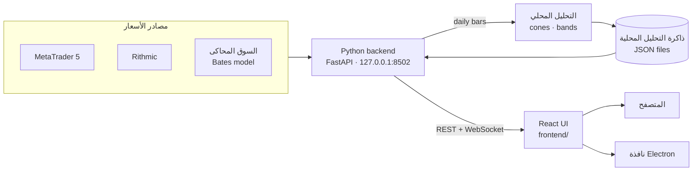

<div align="center">


# Quantum Terminal

<p dir="rtl"><strong>منصة تداول مجانية ومفتوحة المصدر ترسم النماذج الاحتمالية —<br/>الـ volatility cones والـ bands ومستويات الخيارات — فوق الشارت الحي مباشرة.</strong></p>

[English](README.md) · **العربية**

[](https://github.com/wJubran/QuantumTerminal/releases/latest)
[](https://github.com/wJubran/QuantumTerminal/actions/workflows/ci.yml)
[](LICENSE)


<sub dir="rtl">المنصة هنا تعمل على السوق المحاكى المدمج، والـ cones الأسبوعية تحسبها المنصة بنفسها — بدون أي حساب لدى وسيط.</sub>

</div>

---

<div dir="rtl">

## لماذا Quantum Terminal؟

معظم منصات الأفراد مبنية حول مؤشرات متأخرة مثل RSI وMACD. أما Quantum Terminal فيعرض
**المدى الذي يُرجَّح إحصائياً أن يتحرك فيه السعر**: نطاقات توقّع (forecast cones) من نماذج GBM
وMerton jump-diffusion ‏(MJD) وBates، ونطاقات الـ volatility، ومستويات سوق الخيارات (gamma exposure
وجدران call/put والـ max pain)، مرسومة مباشرة فوق الشموع الحية.

وهي **منصة عرض** محلية وسريعة: الحسابات الثقيلة تُجهَّز مسبقاً، فيبقى التطبيق نفسه خفيفاً —
شارت حي وإدخال أوامر وإدارة صفقات، وكل ذلك على جهازك أنت.

## ابدأ بسرعة

إذا كان لديك **Python 3.10** أو أحدث، فأربعة أوامر تكفي. السوق المحاكى يعمل على Windows وmacOS وLinux:

</div>

```bash
git clone https://github.com/wJubran/QuantumTerminal.git
cd QuantumTerminal/backend
pip install -r requirements.txt
python launcher.py --sim
```

<div dir="rtl">

تُفتح المنصة في متصفحك على العنوان **http://127.0.0.1:8502**. لا تسجيل حساب، ولا مفتاح ترخيص، ولا
اشتراك مدفوع. هل أنت جديد على Python، أو تريد أسعاراً حقيقية من MetaTrader 5؟ اتبع
[الدليل خطوة بخطوة](#التثبيت-والتشغيل-خطوة-بخطوة) أدناه.

## المتطلبات

| | المطلوب | ملاحظات |
|---|---|---|
| **نظام التشغيل** | Windows 10 أو 11، أو macOS، أو Linux بنظام 64 بت | MetaTrader 5 يحتاج Windows، أما السوق المحاكى فيعمل على الأنظمة الثلاثة |
| **Python** | الإصدار 3.10 أو أحدث، بنسخة 64 بت | جُرّبت المنصة على 3.10 و3.12 و3.13. على Windows فعّل خيار <code dir="ltr">Add python.exe to PATH</code> أثناء التثبيت |
| **الذاكرة** | ذاكرة بسعة 4 غيغابايت | الـ backend نفسه يستهلك نحو 150 ميغابايت |
| **مساحة القرص** | نحو 1 غيغابايت فارغة | حزم Python تأخذ نحو 500 ميغابايت |
| **المتصفح** | نسخة حديثة من Chrome أو Edge أو Firefox أو Safari | أو استخدم تطبيق سطح المكتب بدلاً منه |
| **الإنترنت** | للتثبيت، ثم فقط لـ MetaTrader 5 والتحقق من التحديثات | السوق المحاكى يعمل دون إنترنت |
| **MetaTrader 5** ‏(اختياري) | منصة MT5 من وسيطك، مع تسجيل الدخول إلى حساب (الحساب التجريبي يكفي) | على Windows فقط، ومطلوبة للأسعار الحقيقية والأوامر الحية |
| **Node.js** ‏(اختياري) | الإصدار 20 أو أحدث | فقط لتطبيق سطح المكتب أو لإعادة بناء الواجهة |
| **Git** ‏(اختياري) | أي إصدار | أو حمّل الكود كملف ZIP |

## التثبيت والتشغيل خطوة بخطوة

### 1. ثبّت Python

- **على Windows:** حمّل مثبّت نسخة 64 بت من [python.org](https://www.python.org/downloads/windows/)،
  وفعّل خيار **Add python.exe to PATH** في الشاشة الأولى. ثم افتح نافذة *Command Prompt* جديدة وتأكد أن
  الأمر <code dir="ltr">python --version</code> يُظهر 3.10 أو أحدث.
- **على macOS:** استخدم المثبّت من [python.org](https://www.python.org/downloads/macos/) أو الأمر
  <code dir="ltr">brew install python@3.12</code>. وعلى macOS وLinux اكتب <code dir="ltr">python3</code>
  أينما ذُكر <code dir="ltr">python</code> في هذا الدليل.
- **على Linux:** ثبّت حزم توزيعتك، فعلى Debian وUbuntu مثلاً نفّذ الأمر
  <code dir="ltr">sudo apt install python3 python3-venv python3-pip</code> في نافذة الأوامر.

### 2. احصل على الكود

</div>

```bash
git clone https://github.com/wJubran/QuantumTerminal.git
cd QuantumTerminal
```

<div dir="rtl">

بدون Git: من صفحة المستودع اضغط **Code ← Download ZIP**، وفُكّ الضغط، ثم افتح نافذة الأوامر داخل المجلد
الناتج، وقد يكون اسمه <code dir="ltr">QuantumTerminal-main</code> بعد فك الضغط.

### 3. أنشئ بيئة افتراضية (مُستحسن)

البيئة الافتراضية (virtual environment) تعزل حزم المنصة عن بقية النظام. أنشئها داخل مجلد المشروع، فهناك
يبحث عنها تطبيق سطح المكتب أيضاً:

</div>

```bat
:: Windows (Command Prompt)
python -m venv .venv
.venv\Scripts\activate
```

```bash
# macOS / Linux
python3 -m venv .venv
source .venv/bin/activate
```

<div dir="rtl">

سيبدأ سطر الأوامر الآن بـ <code dir="ltr">(.venv)</code>. فعّل البيئة من جديد في كل نافذة أوامر جديدة قبل
تشغيل المنصة. وإذا رفض PowerShell تشغيل سكربت التفعيل، فنفّذ مرة واحدة الأمر
<code dir="ltr">Set-ExecutionPolicy -Scope CurrentUser RemoteSigned</code>، أو استخدم نافذة Command Prompt بدلاً منه.

### 4. ثبّت المكتبات المطلوبة

</div>

```bash
cd backend
pip install -r requirements.txt
```

<div dir="rtl">

يستغرق التثبيت الأول بضع دقائق. حزمة <code dir="ltr">MetaTrader5</code> تُثبَّت على Windows فقط، لأن
شركة MetaQuotes لا تنشرها إلا لنظام Windows وحده.

### 5. شغّل المنصة

**على السوق المحاكى** (أي نظام، دون حساب لدى وسيط):

</div>

```bash
python launcher.py --sim
```

<div dir="rtl">

**مع MetaTrader 5** (على Windows):

1. ثبّت MetaTrader 5 من وسيطك وسجّل الدخول إلى حسابك (الحساب التجريبي يكفي).
2. لتتمكن من إرسال الأوامر من Quantum Terminal، فعّل **Algo Trading** في MetaTrader 5 من زره في شريط الأدوات،
   أو من القائمة <code dir="ltr">Tools → Options → Expert Advisors</code> بتفعيل الخيار
   <code dir="ltr">Allow algorithmic trading</code> فيها.
3. اترك MetaTrader 5 مفتوحاً وشغّل الأمر: <code dir="ltr">python launcher.py</code>
4. إذا لم تعثر المنصة على MetaTrader 5 تلقائياً، فاضبطه من *الإعدادات ⚙ ← PROVIDERS*: إما
   **TERMINAL PATH** (مسار الملف <code dir="ltr">terminal64.exe</code>) أو **LOGIN CREDENTIALS** (السيرفر ورقم
   الحساب وكلمة المرور).

يطبع المشغّل عنوان السيرفر وأماكن ملف الإعدادات والبيانات (<code dir="ltr">AppData:</code>) وملف السجل،
ثم يفتح العنوان **http://127.0.0.1:8502** في متصفحك. إذا لم يُفتح المتصفح فافتح العنوان بنفسك. واترك نافذة
المشغّل مفتوحة طوال استخدامك للمنصة.

### 6. أول خطوات داخل المنصة

- **الـ cones:** على الشارت افتح السهم ▾ بجانب **CONES** واختر DAILY أو WEEKLY أو MONTHLY أو QUARTERLY،
  ومنه أيضاً **BATES** لعرض نموذج Bates. في المرة الأولى تكون جاهزة بعد التشغيل بنحو 30 ثانية.
- **التداول:** الأوامر محظورة إلى أن تفعّل *الإعدادات ⚙ ← TRADING ← LIVE TRADING*. وفي المحاكي يفتح هذا
  المفتاح الحساب الورقي فقط (100,000 دولار برافعة 1:100).
- **مركز التعلم:** تبويب **LEARN** يشرح كل صفحة وكل نموذج، بالعربية والإنجليزية.

### 7. الإيقاف وإعادة التشغيل والتحديث

- **الإيقاف:** اضغط <code dir="ltr">Ctrl+C</code> في نافذة المشغّل، أو أغلقها.
- **إعادة التشغيل:** افتح نافذة أوامر داخل مجلد المشروع، وفعّل البيئة الافتراضية (الخطوة 3)، ثم نفّذ
  <code dir="ltr">cd backend</code> و<code dir="ltr">python launcher.py</code> (وأضف
  <code dir="ltr">--sim</code> للسوق المحاكى).
- **التحديث:** داخل مجلد المشروع نفّذ <code dir="ltr">git pull</code>، ثم
  <code dir="ltr">pip install -r backend/requirements.txt</code> والبيئة الافتراضية مفعّلة. تبقى إعداداتك
  والحساب الورقي كما هي، لأنها محفوظة في مجلد <code dir="ltr">AppData:</code> لا في مجلد المشروع.
- **إزالة المنصة:** احذف مجلد المشروع ومجلد <code dir="ltr">AppData:</code> الذي يظهر عند التشغيل.

### تطبيق سطح المكتب (اختياري)

بعد تثبيت Node.js بالإصدار 20 أو أحدث:

</div>

```bash
cd electron_shell
npm install
npm start              # or: npm run start:sim
```

<div dir="rtl">

يشغّل التطبيق الـ backend تلقائياً، مستخدماً البيئة <code dir="ltr">.venv</code> أو
<code dir="ltr">venv</code> في مجلد المشروع إن وُجدت، وإلا فـ Python المثبّت على الجهاز، ويعرض المنصة في
نافذة مستقلة. ويحفظ إعداداته في مجلد خاص به اسمه <code dir="ltr">QuantumTerminal-v2</code>، منفصل عن إعدادات نسخة المتصفح.

### حل المشكلات الشائعة

| المشكلة | الحل |
|---|---|
| رسالة <code dir="ltr">'python' is not recognized</code> على Windows | شغّل مثبّت Python مجدداً وفعّل <code dir="ltr">Add python.exe to PATH</code>، أو اكتب <code dir="ltr">py</code> بدلاً من <code dir="ltr">python</code> |
| رسالة <code dir="ltr">error while attempting to bind on address</code> | المنفذ 8502 مستخدم، غالباً بنسخة أخرى من المنصة. أغلقها، أو شغّل المنصة على منفذ آخر بإضافة <code dir="ltr">--port 8600</code> إلى الأمر |
| لا توجد حزمة <code dir="ltr">MetaTrader5</code> على macOS أو Linux | هذا متوقع، فهي متوفرة لنظام Windows فقط. استخدم الخيار <code dir="ltr">--sim</code> بدلاً منها |
| رسالة <code dir="ltr">MT5 initialize() failed</code> في السجل | تأكد أن MetaTrader 5 مفتوح ومسجَّل الدخول، واضبط TERMINAL PATH من *الإعدادات ⚙ ← PROVIDERS* |
| MetaTrader 5 يرفض الأوامر لأن التداول الآلي معطّل | فعّل **Algo Trading** في MetaTrader 5 |
| لم يُفتح المتصفح، أو بقيت الصفحة فارغة | افتح http://127.0.0.1:8502 بنفسك، وراجع ملف السجل الذي طبعه المشغّل |
| لا تظهر الـ cones على الشارت | انتظر نحو 30 ثانية بعد التشغيل الأول، ثم فعّلها من السهم ▾ بجانب **CONES** |

## المزايا

### تعمل مباشرة بعد التثبيت

| المجال | ما تحصل عليه |
|---|---|
| **الـ Volatility cones** | الـ cones اليومية والأسبوعية والشهرية والفصلية بنماذج GBM وMJD وBates، تحسبها المنصة من الشموع اليومية لمصدر البيانات نفسه ([كيف](#كيف-تحسب-المنصة-الـ-cones)) |
| **الـ bands الاحتمالية** | نطاقات GBM وMJD وBates تبدأ من جديد عند افتتاح كل يوم تداول، ويُحسب اتساعها من آخر 60 يوم تداول، مع توقّع لـ 20 يوم تداول قادمة ([كيف](#كيف-تحسب-المنصة-الـ-bands)) |
| **إعادة العرض (Replay)** | تعيد عرض الـ cones الأسبوعية والشهرية والفصلية السابقة والـ bands اليومية أمام حركة السعر، شمعة بشمعة |
| **Pulse Room** | ماسح يرتّب قائمة المتابعة حسب موقع السعر داخل الـ cones والـ bands |
| **شارت حي** | مكتبة TradingView Lightweight Charts من M1 إلى D1، وعدة شارتات في تبويبات، وأدوات رسم، وقوالب للشارت، وقراءة السعر والوقت بالـ crosshair، وساعة عالمية مع جلسات التداول |
| **إدخال الأوامر** | أوامر market وlimit وstop مع stop loss وtake profit، ومعاينة فورية للمخاطرة والعائد بالمبلغ وبالنسبة من الرصيد |
| **الصفقات** | الصفقات المفتوحة مع المخاطرة والعائد والربح/الخسارة؛ اسحب خطوط SL/TP على الشارت، أو عدّل وأغلق من الجدول؛ وشريط يعرض تعرّض الحساب |
| **مصادر البيانات** | منصة MetaTrader 5 (أسعار حية وتنفيذ أوامر)، وبيانات Rithmic للعقود الآجلة (تحتاج الحزمة الاختيارية async_rithmic) |
| **السوق المحاكى** | أسعار من نموذج Bates ‏(stochastic volatility + jumps) بإيقاع يومي واقعي، متسقة بين الأُطر الزمنية وقابلة للتكرار من الـ seed نفسه؛ وحساب ورقي مع فحص الهامش، وأوامر SL/TP تُنفَّذ عند لمس ذيل الشمعة (wick) |
| **مركز التعلم** | دليل ثنائي اللغة (العربية / English) للمنصة وللنماذج الكمية (GBM وMJD وBates وGEX) ولأنواع الصفقات واختصارات لوحة المفاتيح |
| **تطبيق سطح المكتب** | غلاف Electron اختياري يشغّل الـ backend ويعرض المنصة في نافذة مستقلة |
| **الأمان** | مفتاح التداول مُطفأ افتراضياً، والسيرفر محلي فقط، مع حماية من الطلبات القادمة من مواقع أخرى ومن هجمات DNS rebinding |

### طبقات التحليل — تحتاج بيانات محسوبة مسبقاً

| اللوحة | ما تعرضه |
|---|---|
| **Options Quant** | الـ gamma exposure ‏(GEX) وجدران call/put والـ max pain ومراكز الـ dealers |
| **Regimes** | تصنيف الحالة (regime) الكلية للسوق ولكل أصل، كشريط أعلى الشارت وعليه |
| **Fundamental · Money Flow** | لوحة الاقتصاد الكلي، ودوران القطاعات والدول وفئات الأصول |
| **Options Cockpit** | لوحة الخيارات في Stress Lab |

تقرأ هذه اللوحات ملفات تحليل محسوبة مسبقاً من ذاكرة التخزين المحلية (cache) نفسها التي تُكتب فيها
الـ cones والـ bands. **هذا المستودع لا ينتج هذه الملفات بعد**، لذلك تبقى هذه اللوحات فارغة بعد التثبيت،
ويظهر في أعلى المنصة <code dir="ltr">SERVER ○ NONE</code> لأنه لا يوجد سيرفر بيانات مُعدّ. توسيع المحرك
المحلي ليشمل الـ regimes ومستويات الخيارات وصفحات الاقتصاد الكلي هو أول بند في [خطة التطوير](#خطة-التطوير).

## صور من المنصة

<table>
  <tr>
    <td width="50%"></td>
    <td width="50%"></td>
  </tr>
  <tr>
    <td align="center"><sub>تذكرة الأوامر مع معاينة فورية للمخاطرة والعائد (حساب ورقي)</sub></td>
    <td align="center"><sub>مركز التعلم بالعربية</sub></td>
  </tr>
  <tr>
    <td width="50%"></td>
    <td width="50%"></td>
  </tr>
  <tr>
    <td align="center"><sub>الـ volatility cones مع مستويات TP / الدخول / SL</sub></td>
    <td align="center"><sub>الـ cones والـ bands على شارتين</sub></td>
  </tr>
</table>

<sub>الصورتان الأخيرتان مرسومتان من بيانات تحليل محسوبة مسبقاً، وهي ليست جزءاً من هذا المستودع.</sub>

## كيف تحسب المنصة الـ cones

بعد التشغيل بثوانٍ، ثم كلما ظهرت شمعة يومية جديدة، تعيد المنصة بناء الـ cones لكل أداة من الشموع
اليومية لمصدر البيانات النشط (المجلد <code dir="ltr">backend/local_analysis/</code>):

- **نقطة البداية (anchor):** كل cone يبدأ من افتتاح فترته — يوم التداول أو الأسبوع (الاثنين) أو الشهر
  أو الربع — ويمتد حتى نهاية تلك الفترة. ويعرض الشارت أيضاً cones الفترات السابقة لترى كيف جرت
  التوقعات الماضية.
- **بدون النظر إلى المستقبل:** معاملات كل cone تُقدَّر فقط من نحو 250 عائداً يومياً *قبل* نقطة بدايته.
- **النماذج:** GBM (عوائد طبيعية، بصيغة رياضية مباشرة)؛ وMJD (‏GBM مع قفزات Poisson تُقدَّر من الأيام
  التي تبرز مقارنةً بتذبذب وقتها، بنسب مئوية دقيقة للتوزيع المختلط)؛ وBates (تذبذب عشوائي من نوع Heston مع القفزات نفسها،
  بمحاكاة 25,000 مسار Monte Carlo بـ seed ثابت فتتكرر النتائج نفسها).
- **الخطوط:** الـ median وحدود ±1 و±2 و±3 انحراف معياري (p15.9 / p84.1، وp2.3 / p97.7، وp0.13 / p99.87)،
  مع عائد لوغاريتمي متوقع يساوي صفراً.
- **زمن التداول:** يتقدم الزمن فقط في أيام الأسبوع التي تُتداول فيها الأداة فعلاً، كما تُقرأ من شموعها،
  فلا يتسع الـ cone خلال عطلة نهاية أسبوع يكون فيها السوق مغلقاً.

تُكتب النتائج في ذاكرة التحليل باسمَي <code dir="ltr">{TICKER}_cones.json</code>
و<code dir="ltr">{TICKER}_quarterly_cones.json</code> (ثمانية أرباع: يعرض الشارت أربعة منها، وصفحة
**REPLAY** الثمانية كلها)، وتُكتب الـ cones الأسبوعية والشهرية السابقة التي تعيد صفحة **REPLAY** عرضها في
<code dir="ltr">{TICKER}_historical_cones.json</code>. ولا يُكتب أبداً فوق ملف أنتجه مصدر آخر. فعّل الـ cones
من السهم ▾ بجانب **CONES** (و**BATES**) على الشارت؛ والمتغير <code dir="ltr">MK_LOCAL_ANALYSIS=0</code>
يوقف حسابها.

## كيف تحسب المنصة الـ bands

الـ cone توقّع واحد لكل فترة، أما الـ bands فتبدأ من جديد في كل يوم تداول، لذلك تتحرك مع السعر:

- **نقطة البداية:** افتتاح كل يوم تداول، ولا يستخدم التوقّع إلا العوائد التي قبله.
- **الاتساع:** من تذبذب آخر **60 يوم تداول** دون أيام القفزات. أما شكل الأطراف فيبقى من نافذة الـ cones
  الطويلة (نحو 250 يوماً): قفزات MJD، والتباين طويل المدى وتذبذب التذبذب والارتباط في Bates. لذلك
  تستجيب الـ bands لتغيّر التذبذب خلال أسابيع.
- **التاريخ:** نقطة واحدة لكل يوم بعد الافتتاح بنصف يوم تداول، عند حدود ±1/2/3 انحراف معياري لذلك
  الأفق. ويصل الشارت هذه النقاط وينعّمها فتتكوّن الأغلفة.
- **التوقّع للأمام:** آخر يوم يُمدّ 20 يوم تداول إلى الأمام.
- **الخط الأوسط:** سعر نقطة البداية، وهو مشترك بين النماذج الثلاثة لأن عائدها اللوغاريتمي المتوقع صفر.

تُكتب في <code dir="ltr">{TICKER}_bands.json</code> (للشارت وPulse Room)، ويُكتب توقّع كل يوم في
<code dir="ltr">{TICKER}_bands_replay.json</code> لصفحة **REPLAY**. فعّلها بزر **BANDS** على الشارت أو
بمفتاح **B**، واختر GBM أو MJD أو BATES من السهم ▾ بجانبه.

## كيف تعمل المنصة

يتصل الـ backend بمصدر البيانات عبر واجهة موحّدة للمزوّدين (providers)، ويبث الأسعار إلى الواجهة
عبر WebSocket، ويحسب الـ cones والـ bands في الخلفية، ويقدّم ملفات التحليل عبر REST API. الواجهة تطبيق React 18، ونسختها الجاهزة محفوظة
في المجلد <code dir="ltr">frontend_build/</code>، لذلك لا يحتاج تشغيل المنصة إلى Node.js.

</div>



```text
QuantumTerminal/
├── backend/                 Python backend (FastAPI)
│   ├── launcher.py          entry point: config, UI serving, command-line options
│   ├── data_server.py       REST API + WebSocket price streams
│   ├── providers/           MetaTrader 5, Rithmic, the simulated market (+ Tradovate proof of concept)
│   ├── local_analysis/      cones, bands and Replay files from the feed's daily bars
│   ├── security.py          local-only API guard (cross-site / DNS-rebinding protection)
│   └── tests/               pytest suite — runs without a broker
├── frontend/                React source of the UI (Create React App)
├── frontend_build/          production build served by the backend
├── electron_shell/          optional desktop app
└── screenshots/
```

<div dir="rtl">

## الإعدادات

| الخيار | متغير البيئة | الوظيفة |
|--------|--------------|---------|
| <code dir="ltr">--sim</code> | <code dir="ltr">MK_PROVIDER=sim</code> | سوق محاكى + حساب تداول ورقي |
| <code dir="ltr">--port 8600</code> | <code dir="ltr">MK_PORT</code> | منفذ HTTP (الافتراضي 8502) |
| <code dir="ltr">--no-browser</code> | <code dir="ltr">MK_NO_BROWSER=1</code> | عدم فتح المتصفح تلقائياً |
| | <code dir="ltr">MK_UPDATE_CHECK=0</code> | عدم التحقق من وجود إصدار أحدث على GitHub (تُحفظ نتيجة التحقق 10 دقائق) |
| | <code dir="ltr">MK_LOCAL_ANALYSIS=0</code> | عدم حساب الـ cones والـ bands محلياً |
| | <code dir="ltr">MK_FRONTEND_DIR</code> | تقديم نسخة أخرى من الواجهة |
| | <code dir="ltr">MK_ALLOWED_HOSTS</code> | أسماء مضيف إضافية مسموح لها بالوصول إلى الـ API، مثل عنوان في الشبكة المحلية (القيمة <code dir="ltr">*</code> تلغي هذا الفحص) |
| | <code dir="ltr">MK_CORS_ORIGINS</code> | مصادر متصفح إضافية مسموح لها باستدعاء الـ API (الافتراضي <code dir="ltr">http://localhost:3000</code>) |

تُحفظ إعداداتك في الملف <code dir="ltr">user_config.json</code> داخل المجلد الذي يظهر بجانب
<code dir="ltr">AppData:</code> عند تشغيل المنصة. وإعدادات المحاكي (الـ seed والرصيد الابتدائي
والرافعة) موجودة تحت <code dir="ltr">providers.accounts.sim_default</code>.

## التطوير

- **الـ Backend:** من داخل المجلد <code dir="ltr">backend/</code> نفّذ
  <code dir="ltr">pip install -r requirements-dev.txt</code> ثم <code dir="ltr">python -m pytest</code>.
  الاختبارات تشغّل الـ API الحقيقي كاملاً على السوق المحاكى، فلا تحتاج أي وسيط.
- **الواجهة:** الكود المصدري لـ React موجود في [<code dir="ltr">frontend/</code>](frontend/README.md):
  الأمران <code dir="ltr">npm ci</code> ثم <code dir="ltr">npm start</code> يشغّلان الواجهة مع تحديث
  فوري (hot reload) مقابل backend يعمل. بعد أي تعديل نفّذ <code dir="ltr">npm run build</code> وأضف
  المجلد <code dir="ltr">frontend_build/</code> إلى الـ commit نفسه مع تعديل الكود.
- **الـ CI** يشغّل الاختبارات على Linux وWindows مع Python 3.10 و3.12، ويعيد بناء الواجهة للتأكد
  من تطابق <code dir="ltr">frontend_build/</code> مع الكود المصدري، ويفحص غلاف Electron.

راجع [CONTRIBUTING.md](CONTRIBUTING.md) لطريقة المساهمة، و[CHANGELOG.md](CHANGELOG.md) لما تغيّر في كل إصدار.

## الأمان

يستمع الـ backend على العنوان 127.0.0.1 فقط. ويرفض الطلبات القادمة من مواقع أخرى (عبر فحص الـ Origin
والـ Sec-Fetch-Site، بما في ذلك اتصالات WebSocket)، ومحاولات DNS rebinding (عبر قائمة مسموحة
لقيم الـ Host)، لذلك لا تستطيع أي صفحة ويب تزورها إرسال أوامر أو قراءة بيانات عبر منصتك أثناء
تشغيلها. الأوامر محظورة إلى أن تفعّل التداول بنفسك، واستدعاءات MetaTrader 5 تُنفَّذ بالتتابع.

وجدت ثغرة أمنية؟ أبلغ عنها بشكل خاص لا في issue عام، وراجع [SECURITY.md](SECURITY.md).

## خطة التطوير

- **المحرك الكمّي المحلي، الخطوة التالية:** الـ cones والـ bands تُحسب محلياً؛ والتالي هو الـ regimes
  ومستويات الخيارات، لتعمل كل اللوحات دون بيانات خارجية.
- **وسطاء أكثر:** Interactive Brokers وAlpaca وغيرهما عبر واجهة المزوّدين (الملف
  <code dir="ltr">providers/sim_provider.py</code> مثال كامل).
- **الترجمة:** مركز التعلم يدعم العربية والإنجليزية، وبقية الواجهة بالإنجليزية حالياً.
- **إصدارات جاهزة:** ملفات تثبيت موقّعة لتطبيق سطح المكتب.

المساهمات مرحّب بها — راجع [CONTRIBUTING.md](CONTRIBUTING.md).

## إخلاء المسؤولية

منصة Quantum Terminal أداة للتعليم والتحليل. التداول في الأسواق المالية ينطوي على مخاطر عالية للخسارة
ولا يناسب الجميع. النماذج احتمالية وليست تنبؤية. والأسعار الصادرة عن السوق المحاكى
(<code dir="ltr">--sim</code>) أسعار اصطناعية، ولا يجوز استخدامها أبداً كبيانات سوق.

## الترخيص

مرخّصة بموجب [MIT](LICENSE) © المساهمون في Quantum Terminal

</div>
