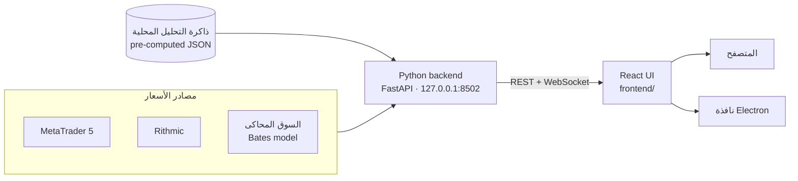

<div align="center">


# Quantum Terminal

<p dir="rtl"><strong>منصة تداول مجانية ومفتوحة المصدر ترسم النماذج الاحتمالية —<br/>الـ volatility cones والـ bands ومستويات الخيارات — فوق الشارت الحي مباشرة.</strong></p>

[English](README.md) · **العربية**

[](https://github.com/wJubran/QuantumTerminal/actions/workflows/ci.yml)
[](LICENSE)


<sub dir="rtl">المنصة هنا تعمل على السوق المحاكى المدمج — بدون أي حساب لدى وسيط.</sub>

</div>

---

<div dir="rtl">

## لماذا Quantum Terminal؟

معظم منصات الأفراد مبنية حول مؤشرات متأخرة مثل RSI وMACD. أما Quantum Terminal فيعرض
**المدى الذي يُرجَّح إحصائياً أن يتحرك فيه السعر**: نطاقات توقّع (forecast cones) من نماذج GBM
وMerton jump-diffusion ‏(MJD) وBates، ونطاقات الـ volatility، ومستويات سوق الخيارات (gamma exposure
وجدران call/put والـ max pain)، مرسومة مباشرة فوق الشموع الحية.

وهي **منصة عرض** محلية وسريعة: الحسابات الثقيلة تُجهَّز مسبقاً، فيبقى التطبيق نفسه خفيفاً —
شارت حي وإدخال أوامر وإدارة صفقات، وكل ذلك على جهازك أنت.

## جرّبها في دقيقتين

كل ما تحتاجه هو **Python 3.10** أو أحدث. السوق المحاكى يعمل على Windows وmacOS وLinux.

</div>

```bash
git clone https://github.com/wJubran/QuantumTerminal.git
cd QuantumTerminal/backend
pip install -r requirements.txt
python launcher.py --sim
```

<div dir="rtl">

تُفتح المنصة في متصفحك على العنوان **http://127.0.0.1:8502**. لا تسجيل حساب، ولا مفتاح ترخيص،
ولا اشتراك مدفوع.

- **التداول الورقي (paper trading):** الأوامر محظورة إلى أن تفعّل *الإعدادات ⚙ ← Trading ← Live trading*.
  في المحاكي يفتح هذا المفتاح الحساب الورقي فقط (100,000 دولار برافعة 1:100).
- **بيانات السوق الحقيقية:** شغّل <code dir="ltr">python launcher.py</code> على Windows مع فتح
  MetaTrader 5 وتسجيل الدخول فيه.
- **أول مرة؟** افتح تبويب **LEARN** — الدليل متوفر بالعربية والإنجليزية.

## المزايا

### تعمل مباشرة بعد التثبيت

| المجال | ما تحصل عليه |
|---|---|
| **شارت حي** | مكتبة TradingView Lightweight Charts من M1 إلى D1، وعدة شارتات في تبويبات، وأدوات رسم، وقوالب للشارت، وقراءة السعر والوقت بالـ crosshair، وساعة عالمية مع جلسات التداول |
| **إدخال الأوامر** | أوامر market وlimit وstop مع stop loss وtake profit، ومعاينة فورية للمخاطرة والعائد بالمبلغ وبالنسبة من الرصيد |
| **الصفقات** | الصفقات المفتوحة مع المخاطرة والعائد والربح/الخسارة؛ اسحب خطوط SL/TP على الشارت، أو عدّل وأغلق من الجدول؛ وشريط يعرض تعرّض الحساب |
| **مصادر البيانات** | منصة MetaTrader 5 (أسعار حية وتنفيذ أوامر)، وبيانات Rithmic للعقود الآجلة (تحتاج الحزمة الاختيارية async_rithmic) |
| **السوق المحاكى** | أسعار من نموذج Bates ‏(stochastic volatility + jumps) بإيقاع يومي واقعي، متسقة بين الأُطر الزمنية وقابلة للتكرار من الـ seed نفسه؛ وحساب ورقي مع فحص الهامش، وأوامر SL/TP تُنفَّذ عند لمس ذيل الشمعة (wick) |
| **مركز التعلم** | دليل ثنائي اللغة (العربية / English) للمنصة وللنماذج الكمية (GBM وMJD وBates وGEX) ولأنواع الصفقات واختصارات لوحة المفاتيح |
| **تطبيق سطح المكتب** | غلاف Electron اختياري يشغّل الـ backend ويعرض المنصة في نافذة مستقلة |
| **الأمان** | مفتاح التداول مُطفأ افتراضياً، والسيرفر محلي فقط، مع حماية من الطلبات القادمة من مواقع أخرى ومن هجمات DNS rebinding |

### طبقات التحليل — تحتاج بيانات محسوبة مسبقاً

| اللوحة | ما تعرضه |
|---|---|
| **Volatility cones** | نطاقات توقّع من GBM وMJD وBates على عدة آفاق زمنية |
| **Bands** | نطاقات volatility وانحراف للتداول اليومي |
| **Options Quant** | الـ gamma exposure ‏(GEX) وجدران call/put والـ max pain ومراكز الـ dealers |
| **Regimes** | تصنيف الحالة (regime) الكلية للسوق ولكل أصل، كشريط أعلى الشارت وعليه |
| **Fundamental · Stress Lab · Replay** | لوحة الاقتصاد الكلي، وPulse Room وOptions Cockpit، وإعادة عرض الـ cones السابقة مقابل حركة السعر |

تقرأ هذه اللوحات ملفات تحليل محسوبة مسبقاً من ذاكرة تخزين محلية (cache). **هذا المستودع لا يتضمن
الأداة التي تنتج هذه الملفات**، لذلك تبقى هذه اللوحات فارغة بعد التثبيت، ويظهر في أعلى المنصة
<code dir="ltr">SERVER ○ NONE</code>. بناء محرك كمّي محلي مفتوح المصدر هو أول بند في
[خطة التطوير](#خطة-التطوير). أما دوران القطاعات والدول في صفحة **Money Flow** فيُجلب مباشرة من
Yahoo Finance ‏(yfinance) ويحتاج اتصالاً بالإنترنت.

## صور من المنصة

<table>
  <tr>
    <td width="50%"></td>
    <td width="50%"></td>
  </tr>
  <tr>
    <td align="center"><sub>تذكرة الأوامر مع معاينة فورية للمخاطرة والعائد (حساب ورقي)</sub></td>
    <td align="center"><sub>مركز التعلم بالعربية</sub></td>
  </tr>
  <tr>
    <td width="50%"></td>
    <td width="50%"></td>
  </tr>
  <tr>
    <td align="center"><sub>الـ volatility cones مع مستويات TP / الدخول / SL</sub></td>
    <td align="center"><sub>الـ cones والـ bands على شارتين</sub></td>
  </tr>
</table>

<sub>الصورتان الأخيرتان مرسومتان من بيانات تحليل محسوبة مسبقاً، وهي ليست جزءاً من هذا المستودع.</sub>

## كيف تعمل المنصة

يتصل الـ backend بمصدر البيانات عبر واجهة موحّدة للمزوّدين (providers)، ويبث الأسعار إلى الواجهة
عبر WebSocket، ويقدّم ملفات التحليل عبر REST API. الواجهة تطبيق React 18، ونسختها الجاهزة محفوظة
في المجلد <code dir="ltr">frontend_build/</code>، لذلك لا يحتاج تشغيل المنصة إلى Node.js.

</div>



```text
QuantumTerminal/
├── backend/                 Python backend (FastAPI)
│   ├── launcher.py          entry point: config, UI serving, command-line options
│   ├── data_server.py       REST API + WebSocket price streams
│   ├── providers/           MetaTrader 5, Rithmic, the simulated market (+ Tradovate proof of concept)
│   ├── security.py          local-only API guard (cross-site / DNS-rebinding protection)
│   └── tests/               pytest suite — runs without a broker
├── frontend/                React source of the UI (Create React App)
├── frontend_build/          production build served by the backend
├── electron_shell/          optional desktop app
└── screenshots/
```

<div dir="rtl">

## الإعدادات

| الخيار | متغير البيئة | الوظيفة |
|--------|--------------|---------|
| <code dir="ltr">--sim</code> | <code dir="ltr">MK_PROVIDER=sim</code> | سوق محاكى + حساب تداول ورقي |
| <code dir="ltr">--port 8600</code> | <code dir="ltr">MK_PORT</code> | منفذ HTTP (الافتراضي 8502) |
| <code dir="ltr">--no-browser</code> | <code dir="ltr">MK_NO_BROWSER=1</code> | عدم فتح المتصفح تلقائياً |
| | <code dir="ltr">MK_UPDATE_CHECK=0</code> | عدم التحقق من وجود إصدار أحدث على GitHub (تُحفظ نتيجة التحقق 10 دقائق) |
| | <code dir="ltr">MK_FRONTEND_DIR</code> | تقديم نسخة أخرى من الواجهة |
| | <code dir="ltr">MK_ALLOWED_HOSTS</code> | أسماء مضيف إضافية مسموح لها بالوصول إلى الـ API، مثل عنوان في الشبكة المحلية (القيمة <code dir="ltr">*</code> تلغي هذا الفحص) |
| | <code dir="ltr">MK_CORS_ORIGINS</code> | مصادر متصفح إضافية مسموح لها باستدعاء الـ API (الافتراضي <code dir="ltr">http://localhost:3000</code>) |

تُحفظ إعداداتك في الملف <code dir="ltr">user_config.json</code> داخل المجلد الذي يظهر بجانب
<code dir="ltr">AppData:</code> عند تشغيل المنصة. وإعدادات المحاكي (الـ seed والرصيد الابتدائي
والرافعة) موجودة تحت <code dir="ltr">providers.accounts.sim_default</code>.

## تطبيق سطح المكتب

</div>

```bash
cd electron_shell
npm install
npm start              # or: npm run start:sim
```

<div dir="rtl">

يشغّل الغلاف الملف <code dir="ltr">backend/launcher.py</code> (مستخدماً البيئة <code dir="ltr">.venv</code>
أو <code dir="ltr">venv</code> إن وُجدت) ويعرض المنصة في نافذة مستقلة. ولتوزيعه كبرنامج قابل للتثبيت
استخدم Electron Forge أو electron-builder.

## التطوير

- **الـ Backend:** من داخل المجلد <code dir="ltr">backend/</code> نفّذ
  <code dir="ltr">pip install -r requirements-dev.txt</code> ثم <code dir="ltr">python -m pytest</code>.
  الاختبارات تشغّل الـ API الحقيقي كاملاً على السوق المحاكى، فلا تحتاج أي وسيط.
- **الواجهة:** الكود المصدري لـ React موجود في [<code dir="ltr">frontend/</code>](frontend/README.md):
  الأمران <code dir="ltr">npm ci</code> ثم <code dir="ltr">npm start</code> يشغّلان الواجهة مع تحديث
  فوري (hot reload) مقابل backend يعمل. بعد أي تعديل نفّذ <code dir="ltr">npm run build</code> وأضف
  المجلد <code dir="ltr">frontend_build/</code> إلى الـ commit نفسه مع تعديل الكود.
- **الـ CI** يشغّل الاختبارات على Linux وWindows مع Python 3.10 و3.12، ويعيد بناء الواجهة للتأكد
  من تطابق <code dir="ltr">frontend_build/</code> مع الكود المصدري، ويفحص غلاف Electron.

راجع [CONTRIBUTING.md](CONTRIBUTING.md) لطريقة المساهمة.

## الأمان

يستمع الـ backend على العنوان 127.0.0.1 فقط. ويرفض الطلبات القادمة من مواقع أخرى (عبر فحص الـ Origin
والـ Sec-Fetch-Site، بما في ذلك اتصالات WebSocket)، ومحاولات DNS rebinding (عبر قائمة مسموحة
لقيم الـ Host)، لذلك لا تستطيع أي صفحة ويب تزورها إرسال أوامر أو قراءة بيانات عبر منصتك أثناء
تشغيلها. الأوامر محظورة إلى أن تفعّل التداول بنفسك، واستدعاءات MetaTrader 5 تُنفَّذ بالتتابع.

وجدت ثغرة أمنية؟ أبلغ عنها بشكل خاص لا في issue عام، وراجع [SECURITY.md](SECURITY.md).

## خطة التطوير

- **محرك كمّي محلي:** حساب الـ cones والـ bands والـ regimes من شموع مصدر البيانات نفسه، لتعمل
  لوحات التحليل دون بيانات خارجية.
- **وسطاء أكثر:** Interactive Brokers وAlpaca وغيرهما عبر واجهة المزوّدين (الملف
  <code dir="ltr">providers/sim_provider.py</code> مثال كامل).
- **الترجمة:** مركز التعلم يدعم العربية والإنجليزية، وبقية الواجهة بالإنجليزية حالياً.
- **إصدارات جاهزة:** ملفات تثبيت موقّعة لتطبيق سطح المكتب.

المساهمات مرحّب بها — راجع [CONTRIBUTING.md](CONTRIBUTING.md).

## إخلاء المسؤولية

منصة Quantum Terminal أداة للتعليم والتحليل. التداول في الأسواق المالية ينطوي على مخاطر عالية للخسارة
ولا يناسب الجميع. النماذج احتمالية وليست تنبؤية. والأسعار الصادرة عن السوق المحاكى
(<code dir="ltr">--sim</code>) أسعار اصطناعية، ولا يجوز استخدامها أبداً كبيانات سوق.

## الترخيص

مرخّصة بموجب [MIT](LICENSE) © المساهمون في Quantum Terminal

</div>
