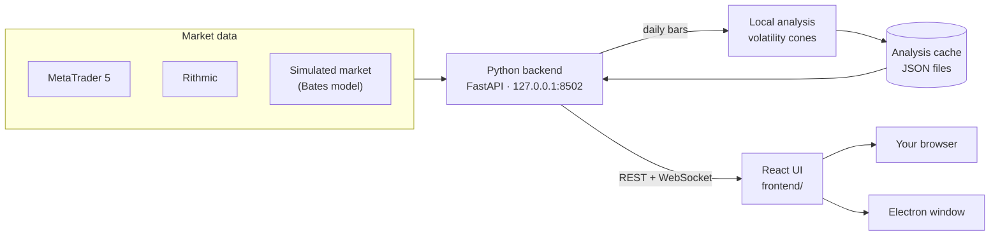

<div align="center">


# Quantum Terminal

**A free, open-source trading terminal that draws probability models —<br/>volatility cones, bands and options levels — on top of live charts.**

**English** · [العربية](README.ar.md)

[](https://github.com/wJubran/QuantumTerminal/actions/workflows/ci.yml)
[](LICENSE)


<sub>Running on the built-in simulated market — the weekly volatility cones are computed by the terminal itself. No broker account needed.</sub>

</div>

---

## Why Quantum Terminal?

Most retail platforms are built around lagging indicators such as RSI or MACD. Quantum Terminal
shows the **range price is statistically expected to travel** instead: forecast cones from GBM,
Merton jump-diffusion (MJD) and Bates models, volatility bands and options-market levels (gamma
exposure, call/put walls, max pain), drawn right on the live candles.

It is a fast, local **display terminal**: heavy calculations are done ahead of time, so the app
itself stays light — live charts, order entry and position management, all on your own computer.

## Try it in two minutes

You only need **Python 3.10+**. The simulated market works on Windows, macOS and Linux.

```bash
git clone https://github.com/wJubran/QuantumTerminal.git
cd QuantumTerminal/backend
pip install -r requirements.txt
python launcher.py --sim
```

The terminal opens in your browser at **http://127.0.0.1:8502**. There is no sign-up, no licence
key and no paywall.

- **Paper trading:** orders are blocked until you switch on *Settings ⚙ → Trading → Live trading*.
  On the simulator that switch only unlocks the paper account (100,000 USD, 1:100 leverage).
- **Real market data:** run `python launcher.py` on Windows with MetaTrader 5 open and logged in.
- **New here?** Open the **LEARN** tab — the guide is in English and Arabic.

## Features

### Works out of the box

| Area | What you get |
|---|---|
| **Volatility cones** | DAILY, WEEKLY, MONTHLY and QUARTERLY cones from GBM, MJD and Bates models, computed by the terminal from the feed's own daily bars ([how](#how-the-cones-are-computed)) |
| **Live charts** | TradingView Lightweight Charts, M1 to D1, several charts in tabs, drawing tools, chart templates, crosshair price/time readout, world clock with trading sessions |
| **Order entry** | Market, limit and stop orders with stop loss / take profit, and a live risk / reward preview in money and in % of the balance |
| **Positions** | Open positions with risk, reward and P&L; drag SL/TP lines on the chart, or edit and close from the table; account exposure strip |
| **Data feeds** | MetaTrader 5 (live prices and order execution) and Rithmic futures data (optional `async_rithmic` package) |
| **Simulated market** | Bates-model prices (stochastic volatility + jumps) with an intraday rhythm, consistent across timeframes and reproducible from a seed; paper account with margin checks and SL/TP that trigger on wicks |
| **Learning Center** | Bilingual (English / العربية) guide to the terminal, the quant models (GBM, MJD, Bates, GEX), trade setups and keyboard shortcuts |
| **Desktop app** | Optional Electron shell that starts the backend and opens the terminal in its own window |
| **Safety** | Trading switch off by default, local-only server, protection against cross-site requests and DNS rebinding |

### Analysis overlays — need pre-computed data

| Panel | What it shows |
|---|---|
| **Bands** | Volatility and deviation bands for intraday trading |
| **Options Quant** | Gamma exposure (GEX), call/put walls, max pain and dealer positioning |
| **Regimes** | Macro and per-asset regime classification, shown as a strip and on the chart |
| **Fundamental · Stress Lab · Replay** | Macro dashboard, Pulse Room and Options Cockpit, and a replay of past cones against price |

These panels read pre-computed analysis files from the same local cache the cones are written to.
**This repository does not produce them yet**, so out of the box they stay empty, and the header shows
`SERVER ○ NONE` because no data server is configured. Extending the local engine to bands and
regimes is the top item on the [roadmap](#roadmap). The **Money Flow** page's sector and country
rotation is fetched live from Yahoo Finance (`yfinance`) and needs internet access.

## Screenshots

<table>
  <tr>
    <td width="50%"></td>
    <td width="50%"></td>
  </tr>
  <tr>
    <td align="center"><sub>Order ticket with a live risk / reward preview (paper account)</sub></td>
    <td align="center"><sub>The Learning Center in Arabic</sub></td>
  </tr>
  <tr>
    <td width="50%"></td>
    <td width="50%"></td>
  </tr>
  <tr>
    <td align="center"><sub>Volatility cones with drift-based TP / entry / SL levels</sub></td>
    <td align="center"><sub>Cones and bands on two charts</sub></td>
  </tr>
</table>

<sub>The last two images were rendered from pre-computed analysis data, which is not part of this repository.</sub>

## How the cones are computed

A few seconds after start-up, and again whenever a new daily bar appears, the terminal rebuilds every
instrument's cones from the active feed's daily bars (`backend/local_analysis/`):

- **Anchors:** each cone starts at the open of its period — the trading day, the week (Monday), the
  month or the quarter — and runs to the end of that period. The chart also shows the previous
  periods' cones, so you can see how past forecasts played out.
- **No look-ahead:** a cone's parameters come only from the ~250 daily returns *before* its anchor.
- **Models:** GBM (normal returns, closed form); MJD (GBM plus Poisson jumps fitted from outlier days,
  exact mixture quantiles); Bates (Heston stochastic variance plus the same jumps, 25,000 Monte Carlo
  paths with a fixed seed, so results are reproducible).
- **Lines:** the median and the ±1, ±2 and ±3 standard-deviation quantiles (p15.9 / p84.1,
  p2.3 / p97.7, p0.13 / p99.87), with a zero expected log return.
- **Trading time:** time advances only on the weekdays the instrument actually trades, read from its
  own bars, so a cone does not widen over a closed weekend.

The results are written to the analysis cache as `{TICKER}_cones.json` and
`{TICKER}_quarterly_cones.json`; a file another producer wrote is never overwritten. Turn the cones on
from the ▾ next to **CONES** (and **BATES**) on a chart; `MK_LOCAL_ANALYSIS=0` turns the computation off.

## How it works



The backend talks to the data feed through a common provider interface, streams prices to the UI
over WebSockets, computes the volatility cones in the background and serves the analysis cache over
REST. The UI is a React 18 app; its production
build is committed in `frontend_build/`, so running the terminal never requires Node.js.

```text
QuantumTerminal/
├── backend/                 Python backend (FastAPI)
│   ├── launcher.py          entry point: config, UI serving, command-line options
│   ├── data_server.py       REST API + WebSocket price streams
│   ├── providers/           MetaTrader 5, Rithmic, the simulated market (+ Tradovate proof of concept)
│   ├── local_analysis/      volatility cones from the feed's daily bars (GBM, MJD, Bates)
│   ├── security.py          local-only API guard (cross-site / DNS-rebinding protection)
│   └── tests/               pytest suite — runs without a broker
├── frontend/                React source of the UI (Create React App)
├── frontend_build/          production build served by the backend
├── electron_shell/          optional desktop app
└── screenshots/
```

## Configuration

| Option | Environment variable | What it does |
|--------|----------------------|--------------|
| `--sim` | `MK_PROVIDER=sim` | Simulated market data + paper trading account |
| `--port 8600` | `MK_PORT` | HTTP port (default `8502`) |
| `--no-browser` | `MK_NO_BROWSER=1` | Don't open the system browser |
| | `MK_UPDATE_CHECK=0` | Don't check GitHub for a newer release (the answer is cached for 10 minutes) |
| | `MK_LOCAL_ANALYSIS=0` | Don't compute the volatility cones locally |
| | `MK_FRONTEND_DIR` | Serve a different UI build |
| | `MK_ALLOWED_HOSTS` | Extra host names allowed to reach the API, e.g. a LAN address (`*` disables the check) |
| | `MK_CORS_ORIGINS` | Extra browser origins allowed to call the API (default: `http://localhost:3000`) |

Your settings are saved in `user_config.json` in the folder printed as `AppData:` when the terminal
starts. The simulator's seed, starting balance and leverage are under
`providers.accounts.sim_default`.

## Desktop app

```bash
cd electron_shell
npm install
npm start              # or: npm run start:sim
```

The shell starts `backend/launcher.py` (using `.venv` or `venv` if present) and shows the terminal
in a native window. Package it with Electron Forge or electron-builder to distribute it.

## Development

- **Backend** — `cd backend && pip install -r requirements-dev.txt && python -m pytest`. The suite
  runs the real API end-to-end on the simulated market, so it needs no broker.
- **UI** — the React source lives in [`frontend/`](frontend/README.md): `npm ci && npm start` gives
  hot reload against a running backend. Run `npm run build` and commit `frontend_build/` together
  with your source change.
- **CI** runs the tests on Linux and Windows with Python 3.10 and 3.12, rebuilds the UI to check that
  `frontend_build/` matches the source, and checks the Electron shell.

See [CONTRIBUTING.md](CONTRIBUTING.md) for the workflow.

## Security

The backend listens on `127.0.0.1` only. It rejects requests from other websites (Origin and
`Sec-Fetch-Site` checks, WebSocket handshakes included) and DNS-rebinding attempts (Host header
allow-list), so a web page you visit cannot place orders or read data through your running terminal.
Orders are blocked until you switch trading on, and calls into MetaTrader 5 are serialized.

Found a vulnerability? Please report it privately; see [SECURITY.md](SECURITY.md).

## Roadmap

- **Local quant engine, next steps** — the cones are computed locally; bands, regimes and options
  levels are next, so every panel works without external data.
- **More brokers** — Interactive Brokers, Alpaca and others through the provider interface
  (`providers/sim_provider.py` is a complete example).
- **Translations** — the Learning Center already supports English and Arabic; the rest of the UI is
  English for now.
- **Packaged releases** — signed desktop installers.

Contributions are welcome — see [CONTRIBUTING.md](CONTRIBUTING.md).

## Disclaimer

Quantum Terminal is for education and analysis. Trading financial markets carries a high risk of
loss and is not suitable for everyone. The models are probabilistic, not predictive. Prices from the
simulated market (`--sim`) are synthetic and must never be used as market data.

## License

[MIT](LICENSE) © Quantum Terminal contributors
