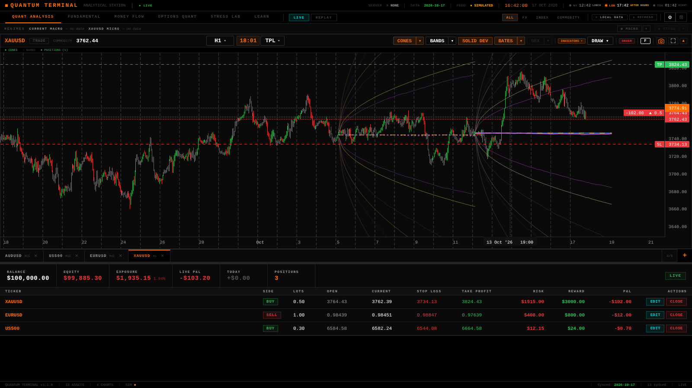
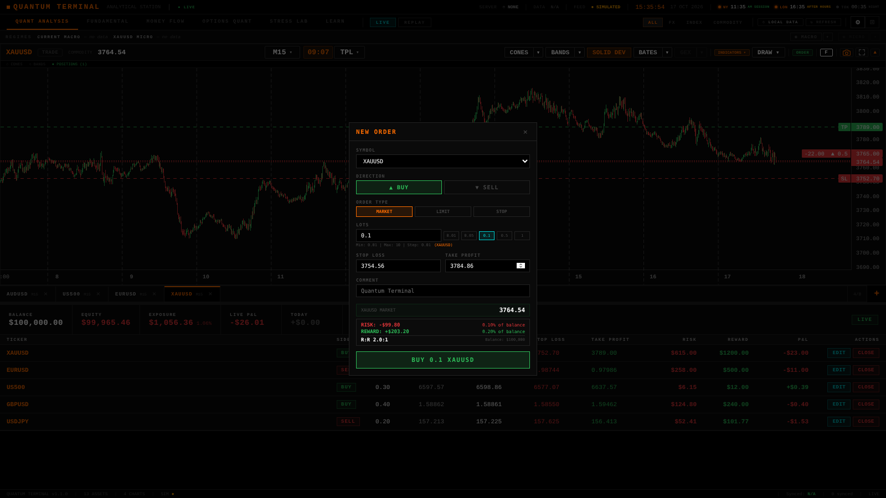
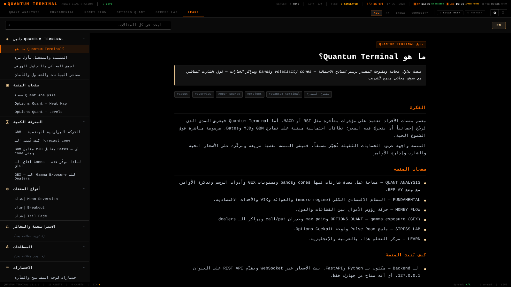
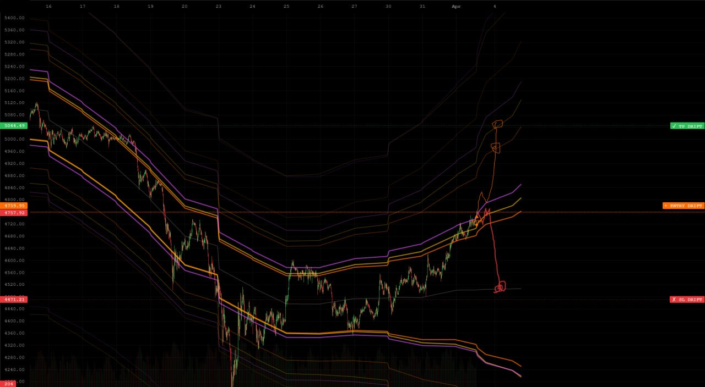
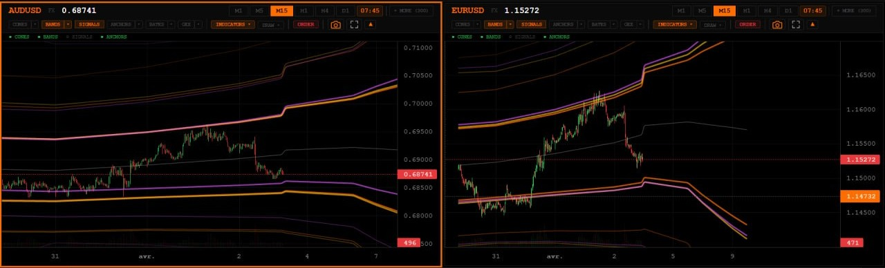
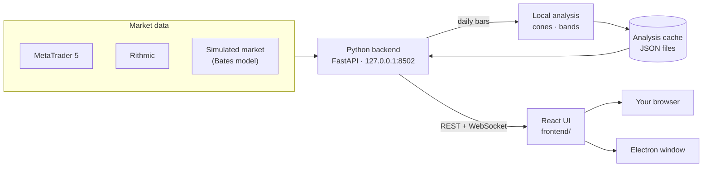

<div align="center">


# Quantum Terminal

**A free, open-source trading terminal that draws probability models —<br/>volatility cones, bands and options levels — on top of live charts.**

**English** · [العربية](README.ar.md)

[](https://github.com/wJubran/QuantumTerminal/releases/latest)
[](https://github.com/wJubran/QuantumTerminal/actions/workflows/ci.yml)
[](LICENSE)




<sub>Running on the built-in simulated market — the weekly volatility cones are computed by the terminal itself. No broker account needed.</sub>

</div>

<div dir="rtl">

> **بالعربية:** ‏Quantum Terminal منصة تداول مجانية ومفتوحة المصدر، ترسم فوق الشارت الحي المدى الذي يُرجَّح
> إحصائياً أن يتحرك فيه السعر، وتعمل على Windows وmacOS وLinux مع سوق محاكى مدمج لا يحتاج أي وسيط.
> **[اقرأ الشرح الكامل بالعربية، مع المتطلبات وطريقة التشغيل خطوة بخطوة ↓](#الشرح-بالعربية)**

</div>

---

## Why Quantum Terminal?

Most retail platforms are built around lagging indicators such as RSI or MACD. Quantum Terminal
shows the **range price is statistically expected to travel** instead: forecast cones from GBM,
Merton jump-diffusion (MJD) and Bates models, volatility bands and options-market levels (gamma
exposure, call/put walls, max pain), drawn right on the live candles.

It is a fast, local **display terminal**: heavy calculations run in the background, so the app
itself stays light — live charts, order entry and position management, all on your own computer.

## Quick start

If you already have **Python 3.10+**, four commands are enough. The simulated market works on Windows,
macOS and Linux:

```bash
git clone https://github.com/wJubran/QuantumTerminal.git
cd QuantumTerminal/backend
pip install -r requirements.txt
python launcher.py --sim
```

The terminal opens in your browser at **http://127.0.0.1:8502**. There is no sign-up, no licence
key and no paywall. New to Python, or want real prices from MetaTrader 5? Follow the
[step-by-step guide](#installation-step-by-step) below.

## Requirements

| | What you need | Notes |
|---|---|---|
| **Operating system** | Windows 10 or 11, macOS, or Linux (64-bit) | MetaTrader 5 needs Windows; the simulated market runs everywhere |
| **Python** | 3.10 or newer, 64-bit | Tested with 3.10, 3.12 and 3.13. On Windows, tick *Add python.exe to PATH* in the installer |
| **Memory** | 4 GB of RAM | The backend itself uses about 150 MB |
| **Disk space** | About 1 GB free | The Python packages take about 500 MB |
| **Browser** | A current Chrome, Edge, Firefox or Safari | Or use the desktop app instead |
| **Internet** | To install; afterwards only for MetaTrader 5 and the update check | The simulated market works offline |
| **MetaTrader 5** *(optional)* | The MT5 desktop terminal from your broker, logged in to an account (a demo account is fine) | Windows only. Needed for real prices and live orders |
| **Node.js** *(optional)* | 20 or newer | Only for the desktop app or to rebuild the UI |
| **Git** *(optional)* | Any version | Or download the code as a ZIP file |

## Installation, step by step

### 1. Install Python

- **Windows:** download the 64-bit installer from [python.org](https://www.python.org/downloads/windows/)
  and tick **Add python.exe to PATH** on the first screen. Then open a new *Command Prompt* and check
  that `python --version` prints 3.10 or newer.
- **macOS:** use the installer from [python.org](https://www.python.org/downloads/macos/) or
  `brew install python@3.12`. On macOS and Linux, type `python3` wherever this guide says `python`.
- **Linux:** install your distribution's packages, e.g. `sudo apt install python3 python3-venv python3-pip`
  on Debian or Ubuntu.

### 2. Get the code

```bash
git clone https://github.com/wJubran/QuantumTerminal.git
cd QuantumTerminal
```

Without Git: on the repository page click **Code → Download ZIP**, extract it, and open a terminal in
the extracted folder (it may be called `QuantumTerminal-main`).

### 3. Create a virtual environment (recommended)

A virtual environment keeps the terminal's packages separate from the rest of your system. Create it
in the project folder, where the desktop app also looks for it:

```bat
:: Windows (Command Prompt)
python -m venv .venv
.venv\Scripts\activate
```

```bash
# macOS / Linux
python3 -m venv .venv
source .venv/bin/activate
```

Your prompt now starts with `(.venv)`. Activate it again in every new terminal window before you start
the terminal. If PowerShell refuses to run the activation script, run
`Set-ExecutionPolicy -Scope CurrentUser RemoteSigned` once, or use Command Prompt.

### 4. Install the dependencies

```bash
cd backend
pip install -r requirements.txt
```

The first install takes a few minutes. The `MetaTrader5` package is only installed on Windows,
because MetaQuotes publishes it for Windows only.

### 5. Start the terminal

**On the simulated market** (any system, no broker account):

```bash
python launcher.py --sim
```

**With MetaTrader 5** (Windows):

1. Install MetaTrader 5 from your broker and log in to your account (a demo account is fine).
2. To place orders from Quantum Terminal, turn on **Algo Trading** in MetaTrader 5 (the toolbar
   button, or *Tools → Options → Expert Advisors → Allow algorithmic trading*).
3. Leave MetaTrader 5 running and start:

   ```bash
   python launcher.py
   ```

4. If the terminal does not find MetaTrader 5 on its own, set it under
   *Settings ⚙ → PROVIDERS*: **TERMINAL PATH** (the path to `terminal64.exe`) or
   **LOGIN CREDENTIALS** (server, login and password).

The launcher prints the server address and where it keeps its config, data (`AppData:`) and log file,
then opens **http://127.0.0.1:8502** in your browser. If the browser does not open, open that address
yourself. Keep the launcher window open while you use the terminal.

### 6. First steps in the terminal

- **Cones:** on a chart, open the ▾ next to **CONES** and pick DAILY, WEEKLY, MONTHLY or QUARTERLY (and
  **BATES** for the Bates model). The first time, they are ready about 30 seconds after start-up.
- **Trading:** orders are blocked until you switch on *Settings ⚙ → TRADING → LIVE TRADING*. On the
  simulator, that switch only unlocks the paper account (100,000 USD, 1:100 leverage).
- **Learning Center:** the **LEARN** tab explains every page and model, in English and Arabic.

### 7. Stop, restart and update

- **Stop:** press `Ctrl+C` in the launcher window, or close it.
- **Restart:** open a terminal in the project folder, activate the virtual environment (step 3), then run
  `cd backend` and `python launcher.py` (add `--sim` for the simulated market).
- **Update:** in the project folder run `git pull`, then `pip install -r backend/requirements.txt` with the
  virtual environment active. Your settings and the paper account are kept: they live in the
  `AppData:` folder, not in the project folder.
- **Uninstall:** delete the project folder and the `AppData:` folder printed at start-up.

### Desktop app (optional)

With Node.js 20 or newer installed:

```bash
cd electron_shell
npm install
npm start              # or: npm run start:sim
```

The app starts the backend for you, using the project's `.venv` (or `venv`) when it exists and the
Python on your `PATH` otherwise, and shows the terminal in its own window. It keeps its settings in a
separate folder (`QuantumTerminal-v2`) from the browser version. Package it with Electron Forge or
electron-builder to distribute it.

### Troubleshooting

| Problem | What to do |
|---|---|
| `'python' is not recognized` (Windows) | Run the Python installer again and tick *Add python.exe to PATH*, or type `py` instead of `python` |
| `error while attempting to bind on address` | Port 8502 is in use, usually by another copy of the terminal. Close it, or start with `--port 8600` |
| No `MetaTrader5` package on macOS or Linux | Expected: it exists for Windows only. Use `--sim` |
| `MT5 initialize() failed` in the log | Check that MetaTrader 5 is open and logged in, and set TERMINAL PATH under *Settings ⚙ → PROVIDERS* |
| MetaTrader 5 rejects orders because algo trading is disabled | Turn on **Algo Trading** in MetaTrader 5 |
| The browser did not open, or the page stays empty | Open http://127.0.0.1:8502 yourself, and look at the log file the launcher printed |
| No cones on the chart | Wait about 30 seconds after the first start, then turn them on from the ▾ next to **CONES** |

## Features

### Works out of the box

| Area | What you get |
|---|---|
| **Volatility cones** | DAILY, WEEKLY, MONTHLY and QUARTERLY cones from GBM, MJD and Bates models, computed by the terminal from the feed's own daily bars ([how](#how-the-cones-are-computed)) |
| **Probability bands** | Rolling GBM, MJD and Bates bands that restart at every trading day's open, with their width taken from the last 60 trading days and a 20-day forward fan ([how](#how-the-bands-are-computed)) |
| **Replay** | Plays back past weekly, monthly and quarterly cones and the daily bands against price, bar by bar |
| **Pulse Room** | Scanner that ranks your watchlist by where price sits inside its cones and bands |
| **Live charts** | TradingView Lightweight Charts, M1 to D1, several charts in tabs, drawing tools, chart templates, crosshair price/time readout, world clock with trading sessions |
| **Order entry** | Market, limit and stop orders with stop loss / take profit, and a live risk / reward preview in money and in % of the balance |
| **Positions** | Open positions with risk, reward and P&L; drag SL/TP lines on the chart, or edit and close from the table; account exposure strip |
| **Data feeds** | MetaTrader 5 (live prices and order execution) and Rithmic futures data (optional `async_rithmic` package) |
| **Simulated market** | Bates-model prices (stochastic volatility + jumps) with an intraday rhythm, consistent across timeframes and reproducible from a seed; paper account with margin checks and SL/TP that trigger on wicks |
| **Learning Center** | Bilingual (English / العربية) guide to the terminal, the quant models (GBM, MJD, Bates, GEX), trade setups and keyboard shortcuts |
| **Desktop app** | Optional Electron shell that starts the backend and opens the terminal in its own window |
| **Safety** | Trading switch off by default, local-only server, protection against cross-site requests and DNS rebinding |

### Analysis overlays — need pre-computed data

| Panel | What it shows |
|---|---|
| **Options Quant** | Gamma exposure (GEX), call/put walls, max pain and dealer positioning |
| **Regimes** | Macro and per-asset regime classification, shown as a strip and on the chart |
| **Fundamental · Money Flow** | Macro dashboard, and sector, country and asset-class rotation |
| **Options Cockpit** | The options view in Stress Lab |

These panels read pre-computed analysis files from the same local cache the cones and bands are written
to. **This repository does not produce them yet**, so out of the box they stay empty, and the header
shows `SERVER ○ NONE` because no data server is configured. Extending the local engine to regimes,
options levels and the macro pages is the top item on the [roadmap](#roadmap).

## Screenshots

<table>
  <tr>
    <td width="50%"></td>
    <td width="50%"></td>
  </tr>
  <tr>
    <td align="center"><sub>Order ticket with a live risk / reward preview (paper account)</sub></td>
    <td align="center"><sub>The Learning Center in Arabic</sub></td>
  </tr>
  <tr>
    <td width="50%"></td>
    <td width="50%"></td>
  </tr>
  <tr>
    <td align="center"><sub>Volatility cones with drift-based TP / entry / SL levels</sub></td>
    <td align="center"><sub>Cones and bands on two charts</sub></td>
  </tr>
</table>

<sub>The last two images were rendered from pre-computed analysis data, which is not part of this repository.</sub>

## How the cones are computed

A few seconds after start-up, and again whenever a new daily bar appears, the terminal rebuilds every
instrument's cones from the active feed's daily bars (`backend/local_analysis/`):

- **Anchors:** each cone starts at the open of its period — the trading day, the week (Monday), the
  month or the quarter — and runs to the end of that period. The chart also shows the previous
  periods' cones, so you can see how past forecasts played out.
- **No look-ahead:** a cone's parameters come only from the ~250 daily returns *before* its anchor.
- **Models:** GBM (normal returns, closed form); MJD (GBM plus Poisson jumps, fitted from the days that
  stand out against the volatility of their time; exact mixture quantiles); Bates (Heston stochastic variance plus the same jumps, 25,000 Monte Carlo
  paths with a fixed seed, so results are reproducible).
- **Lines:** the median and the ±1, ±2 and ±3 standard-deviation quantiles (p15.9 / p84.1,
  p2.3 / p97.7, p0.13 / p99.87), with a zero expected log return.
- **Trading time:** time advances only on the weekdays the instrument actually trades, read from its
  own bars, so a cone does not widen over a closed weekend.

The results are written to the analysis cache as `{TICKER}_cones.json` and
`{TICKER}_quarterly_cones.json` (eight quarters: the chart shows four, the **REPLAY** page all eight), and
the past weekly and monthly cones the **REPLAY** page plays back as `{TICKER}_historical_cones.json`. A
file another producer wrote is never overwritten. Turn the cones on from the ▾ next to **CONES** (and
**BATES**) on a chart; `MK_LOCAL_ANALYSIS=0` turns the computation off.

## How the bands are computed

A cone is one forecast per period. The bands start again every trading day, so they follow the price:

- **Anchor:** every trading day's open. The forecast uses only the returns before it.
- **Width:** the volatility of the last **60 trading days**, leaving out jump days. The tails keep the
  cones' long-run shape: MJD's jumps, and Bates' long-run variance, vol of vol and correlation, all from
  ~250 days. So the bands react to a change in volatility within weeks.
- **History:** one point per day, half a trading day after the open, at that horizon's ±1/2/3-sigma
  quantiles. The chart joins and smooths these points into the envelope.
- **Forward fan:** the newest day is projected 20 trading days ahead.
- **Centre line:** the anchor price, shared by the three models, which all have a zero expected log return.

They are written as `{TICKER}_bands.json` (chart, Pulse Room), and every day's forward fan as
`{TICKER}_bands_replay.json` for the **REPLAY** page. Turn them on with **BANDS** on a chart, or the **B**
key, and pick GBM, MJD or BATES from its ▾.

## How it works



The backend talks to the data feed through a common provider interface, streams prices to the UI
over WebSockets, computes the cones and bands in the background and serves the analysis cache over
REST. The UI is a React 18 app; its production
build is committed in `frontend_build/`, so running the terminal never requires Node.js.

```text
QuantumTerminal/
├── backend/                 Python backend (FastAPI)
│   ├── launcher.py          entry point: config, UI serving, command-line options
│   ├── data_server.py       REST API + WebSocket price streams
│   ├── providers/           MetaTrader 5, Rithmic, the simulated market (+ Tradovate proof of concept)
│   ├── local_analysis/      cones, bands and Replay files from the feed's daily bars
│   ├── security.py          local-only API guard (cross-site / DNS-rebinding protection)
│   └── tests/               pytest suite — runs without a broker
├── frontend/                React source of the UI (Create React App)
├── frontend_build/          production build served by the backend
├── electron_shell/          optional desktop app
└── screenshots/
```

## Configuration

| Option | Environment variable | What it does |
|--------|----------------------|--------------|
| `--sim` | `MK_PROVIDER=sim` | Simulated market data + paper trading account |
| `--port 8600` | `MK_PORT` | HTTP port (default `8502`) |
| `--no-browser` | `MK_NO_BROWSER=1` | Don't open the system browser |
| | `MK_UPDATE_CHECK=0` | Don't check GitHub for a newer release (the answer is cached for 10 minutes) |
| | `MK_LOCAL_ANALYSIS=0` | Don't compute the cones and bands locally |
| | `MK_FRONTEND_DIR` | Serve a different UI build |
| | `MK_ALLOWED_HOSTS` | Extra host names allowed to reach the API, e.g. a LAN address (`*` disables the check) |
| | `MK_CORS_ORIGINS` | Extra browser origins allowed to call the API (default: `http://localhost:3000`) |

Your settings are saved in `user_config.json` in the folder printed as `AppData:` when the terminal
starts. The simulator's seed, starting balance and leverage are under
`providers.accounts.sim_default`.

## Development

- **Backend** — `cd backend && pip install -r requirements-dev.txt && python -m pytest`. The suite
  runs the real API end-to-end on the simulated market, so it needs no broker.
- **UI** — the React source lives in [`frontend/`](frontend/README.md): `npm ci && npm start` gives
  hot reload against a running backend. Run `npm run build` and commit `frontend_build/` together
  with your source change.
- **CI** runs the tests on Linux and Windows with Python 3.10 and 3.12, rebuilds the UI to check that
  `frontend_build/` matches the source, and checks the Electron shell.

See [CONTRIBUTING.md](CONTRIBUTING.md) for the workflow, and [CHANGELOG.md](CHANGELOG.md) for what changed in each release.

## Security

The backend listens on `127.0.0.1` only. It rejects requests from other websites (Origin and
`Sec-Fetch-Site` checks, WebSocket handshakes included) and DNS-rebinding attempts (Host header
allow-list), so a web page you visit cannot place orders or read data through your running terminal.
Orders are blocked until you switch trading on, and calls into MetaTrader 5 are serialized.

Found a vulnerability? Please report it privately; see [SECURITY.md](SECURITY.md).

## Roadmap

- **Local quant engine, next steps** — the cones and bands are computed locally; regimes and options
  levels are next, so every panel works without external data.
- **More brokers** — Interactive Brokers, Alpaca and others through the provider interface
  (`providers/sim_provider.py` is a complete example).
- **Translations** — the Learning Center already supports English and Arabic; the rest of the UI is
  English for now.
- **Packaged releases** — signed desktop installers.

Contributions are welcome — see [CONTRIBUTING.md](CONTRIBUTING.md).

## Disclaimer

Quantum Terminal is for education and analysis. Trading financial markets carries a high risk of
loss and is not suitable for everyone. The models are probabilistic, not predictive. Prices from the
simulated market (`--sim`) are synthetic and must never be used as market data.

---

<div dir="rtl">

## الشرح بالعربية

### ما هي Quantum Terminal؟

منصة تداول **مجانية ومفتوحة المصدر** تعمل على جهازك أنت. معظم منصات الأفراد مبنية حول مؤشرات متأخرة
مثل RSI وMACD، أما Quantum Terminal فترسم فوق الشموع الحية **المدى الذي يُرجَّح إحصائياً أن يتحرك فيه
السعر**: نطاقات توقّع (volatility cones) من نماذج GBM وMJD وBates، تحسبها المنصة بنفسها من بيانات السوق.
ومعها شارت حي، وإدخال أوامر مع وقف الخسارة وجني الربح، وإدارة للصفقات، وسوق محاكى كامل بحساب تداول
ورقي لتجرّب كل شيء دون أي وسيط ودون أي مخاطرة. لا تسجيل حساب، ولا مفتاح ترخيص، ولا اشتراك مدفوع.

### أبرز المزايا

- **الـ volatility cones:** يومية وأسبوعية وشهرية وفصلية بثلاثة نماذج (GBM وMJD وBates)، تُحسب من الشموع
  اليومية لمصدر البيانات نفسه، دون النظر إلى المستقبل، وتتحدّث تلقائياً مع كل شمعة يومية جديدة.
- **الـ bands الاحتمالية:** تبدأ من جديد عند افتتاح كل يوم تداول ويُحسب اتساعها من آخر 60 يوم تداول،
  فتتحرك مع السعر، مع توقّع لـ 20 يوم تداول قادمة. وصفحة REPLAY تعيد عرض الـ cones والـ bands السابقة
  أمام حركة السعر شمعة بشمعة.
- **شارت حي:** من M1 إلى D1، عدة شارتات في تبويبات، أدوات رسم، قوالب، وساعة عالمية بجلسات التداول.
- **الأوامر والصفقات:** أوامر market وlimit وstop مع SL/TP، ومعاينة فورية للمخاطرة والعائد، وسحب خطوط
  SL/TP على الشارت.
- **السوق المحاكى:** أسعار من نموذج Bates متسقة بين كل الأطر الزمنية، وحساب ورقي برصيد 100,000 دولار.
- **مصادر البيانات:** MetaTrader 5 (أسعار حية وتنفيذ أوامر) وبيانات Rithmic للعقود الآجلة.
- **مركز التعلم:** دليل كامل بالعربية والإنجليزية داخل المنصة.
- **الأمان:** السيرفر محلي فقط، ولا تستطيع أي صفحة ويب تزورها إرسال أوامر عبر منصتك.

لوحات Options Quant وRegimes وFundamental وMoney Flow تحتاج بيانات تحليل محسوبة مسبقاً لا ينتجها
المستودع بعد، فتبقى فارغة حالياً. التفاصيل في [النسخة العربية الكاملة](README.ar.md).

### المتطلبات

| | المطلوب | ملاحظات |
|---|---|---|
| **نظام التشغيل** | Windows 10 أو 11، أو macOS، أو Linux بنظام 64 بت | MetaTrader 5 يحتاج Windows، أما السوق المحاكى فيعمل على الأنظمة الثلاثة |
| **Python** | الإصدار 3.10 أو أحدث، بنسخة 64 بت | جُرّبت المنصة على 3.10 و3.12 و3.13. على Windows فعّل خيار <code dir="ltr">Add python.exe to PATH</code> أثناء التثبيت |
| **الذاكرة** | ذاكرة بسعة 4 غيغابايت | الـ backend نفسه يستهلك نحو 150 ميغابايت |
| **مساحة القرص** | نحو 1 غيغابايت فارغة | حزم Python تأخذ نحو 500 ميغابايت |
| **المتصفح** | نسخة حديثة من Chrome أو Edge أو Firefox أو Safari | أو استخدم تطبيق سطح المكتب بدلاً منه |
| **الإنترنت** | للتثبيت، ثم فقط لـ MetaTrader 5 والتحقق من التحديثات | السوق المحاكى يعمل دون إنترنت |
| **MetaTrader 5** ‏(اختياري) | منصة MT5 من وسيطك، مع تسجيل الدخول إلى حساب (الحساب التجريبي يكفي) | على Windows فقط، ومطلوبة للأسعار الحقيقية والأوامر الحية |
| **Node.js** ‏(اختياري) | الإصدار 20 أو أحدث | فقط لتطبيق سطح المكتب أو لإعادة بناء الواجهة |
| **Git** ‏(اختياري) | أي إصدار | أو حمّل الكود كملف ZIP |

### التثبيت والتشغيل خطوة بخطوة

#### 1. ثبّت Python

- **على Windows:** حمّل مثبّت نسخة 64 بت من [python.org](https://www.python.org/downloads/windows/)،
  وفعّل خيار **Add python.exe to PATH** في الشاشة الأولى. ثم افتح نافذة *Command Prompt* جديدة وتأكد أن
  الأمر <code dir="ltr">python --version</code> يُظهر 3.10 أو أحدث.
- **على macOS:** استخدم المثبّت من [python.org](https://www.python.org/downloads/macos/) أو الأمر
  <code dir="ltr">brew install python@3.12</code>. وعلى macOS وLinux اكتب <code dir="ltr">python3</code>
  أينما ذُكر <code dir="ltr">python</code> في هذا الدليل.
- **على Linux:** ثبّت حزم توزيعتك، فعلى Debian وUbuntu مثلاً نفّذ الأمر
  <code dir="ltr">sudo apt install python3 python3-venv python3-pip</code> في نافذة الأوامر.

#### 2. احصل على الكود

</div>

```bash
git clone https://github.com/wJubran/QuantumTerminal.git
cd QuantumTerminal
```

<div dir="rtl">

بدون Git: من صفحة المستودع اضغط **Code ← Download ZIP**، وفُكّ الضغط، ثم افتح نافذة الأوامر داخل المجلد
الناتج، وقد يكون اسمه <code dir="ltr">QuantumTerminal-main</code> بعد فك الضغط.

#### 3. أنشئ بيئة افتراضية (مُستحسن)

البيئة الافتراضية (virtual environment) تعزل حزم المنصة عن بقية النظام. أنشئها داخل مجلد المشروع، فهناك
يبحث عنها تطبيق سطح المكتب أيضاً:

</div>

```bat
:: Windows (Command Prompt)
python -m venv .venv
.venv\Scripts\activate
```

```bash
# macOS / Linux
python3 -m venv .venv
source .venv/bin/activate
```

<div dir="rtl">

سيبدأ سطر الأوامر الآن بـ <code dir="ltr">(.venv)</code>. فعّل البيئة من جديد في كل نافذة أوامر جديدة قبل
تشغيل المنصة. وإذا رفض PowerShell تشغيل سكربت التفعيل، فنفّذ مرة واحدة الأمر
<code dir="ltr">Set-ExecutionPolicy -Scope CurrentUser RemoteSigned</code>، أو استخدم نافذة Command Prompt بدلاً منه.

#### 4. ثبّت المكتبات المطلوبة

</div>

```bash
cd backend
pip install -r requirements.txt
```

<div dir="rtl">

يستغرق التثبيت الأول بضع دقائق. حزمة <code dir="ltr">MetaTrader5</code> تُثبَّت على Windows فقط، لأن
شركة MetaQuotes لا تنشرها إلا لنظام Windows وحده.

#### 5. شغّل المنصة

**على السوق المحاكى** (أي نظام، دون حساب لدى وسيط):

</div>

```bash
python launcher.py --sim
```

<div dir="rtl">

**مع MetaTrader 5** (على Windows):

1. ثبّت MetaTrader 5 من وسيطك وسجّل الدخول إلى حسابك (الحساب التجريبي يكفي).
2. لتتمكن من إرسال الأوامر من Quantum Terminal، فعّل **Algo Trading** في MetaTrader 5 من زره في شريط الأدوات،
   أو من القائمة <code dir="ltr">Tools → Options → Expert Advisors</code> بتفعيل الخيار
   <code dir="ltr">Allow algorithmic trading</code> فيها.
3. اترك MetaTrader 5 مفتوحاً وشغّل الأمر: <code dir="ltr">python launcher.py</code>
4. إذا لم تعثر المنصة على MetaTrader 5 تلقائياً، فاضبطه من *الإعدادات ⚙ ← PROVIDERS*: إما
   **TERMINAL PATH** (مسار الملف <code dir="ltr">terminal64.exe</code>) أو **LOGIN CREDENTIALS** (السيرفر ورقم
   الحساب وكلمة المرور).

يطبع المشغّل عنوان السيرفر وأماكن ملف الإعدادات والبيانات (<code dir="ltr">AppData:</code>) وملف السجل،
ثم يفتح العنوان **http://127.0.0.1:8502** في متصفحك. إذا لم يُفتح المتصفح فافتح العنوان بنفسك. واترك نافذة
المشغّل مفتوحة طوال استخدامك للمنصة.

#### 6. أول خطوات داخل المنصة

- **الـ cones:** على الشارت افتح السهم ▾ بجانب **CONES** واختر DAILY أو WEEKLY أو MONTHLY أو QUARTERLY،
  ومنه أيضاً **BATES** لعرض نموذج Bates. في المرة الأولى تكون جاهزة بعد التشغيل بنحو 30 ثانية.
- **التداول:** الأوامر محظورة إلى أن تفعّل *الإعدادات ⚙ ← TRADING ← LIVE TRADING*. وفي المحاكي يفتح هذا
  المفتاح الحساب الورقي فقط (100,000 دولار برافعة 1:100).
- **مركز التعلم:** تبويب **LEARN** يشرح كل صفحة وكل نموذج، بالعربية والإنجليزية.

#### 7. الإيقاف وإعادة التشغيل والتحديث

- **الإيقاف:** اضغط <code dir="ltr">Ctrl+C</code> في نافذة المشغّل، أو أغلقها.
- **إعادة التشغيل:** افتح نافذة أوامر داخل مجلد المشروع، وفعّل البيئة الافتراضية (الخطوة 3)، ثم نفّذ
  <code dir="ltr">cd backend</code> و<code dir="ltr">python launcher.py</code> (وأضف
  <code dir="ltr">--sim</code> للسوق المحاكى).
- **التحديث:** داخل مجلد المشروع نفّذ <code dir="ltr">git pull</code>، ثم
  <code dir="ltr">pip install -r backend/requirements.txt</code> والبيئة الافتراضية مفعّلة. تبقى إعداداتك
  والحساب الورقي كما هي، لأنها محفوظة في مجلد <code dir="ltr">AppData:</code> لا في مجلد المشروع.
- **إزالة المنصة:** احذف مجلد المشروع ومجلد <code dir="ltr">AppData:</code> الذي يظهر عند التشغيل.

#### تطبيق سطح المكتب (اختياري)

بعد تثبيت Node.js بالإصدار 20 أو أحدث:

</div>

```bash
cd electron_shell
npm install
npm start              # or: npm run start:sim
```

<div dir="rtl">

يشغّل التطبيق الـ backend تلقائياً، مستخدماً البيئة <code dir="ltr">.venv</code> أو
<code dir="ltr">venv</code> في مجلد المشروع إن وُجدت، وإلا فـ Python المثبّت على الجهاز، ويعرض المنصة في
نافذة مستقلة. ويحفظ إعداداته في مجلد خاص به اسمه <code dir="ltr">QuantumTerminal-v2</code>، منفصل عن إعدادات نسخة المتصفح.

#### حل المشكلات الشائعة

| المشكلة | الحل |
|---|---|
| رسالة <code dir="ltr">'python' is not recognized</code> على Windows | شغّل مثبّت Python مجدداً وفعّل <code dir="ltr">Add python.exe to PATH</code>، أو اكتب <code dir="ltr">py</code> بدلاً من <code dir="ltr">python</code> |
| رسالة <code dir="ltr">error while attempting to bind on address</code> | المنفذ 8502 مستخدم، غالباً بنسخة أخرى من المنصة. أغلقها، أو شغّل المنصة على منفذ آخر بإضافة <code dir="ltr">--port 8600</code> إلى الأمر |
| لا توجد حزمة <code dir="ltr">MetaTrader5</code> على macOS أو Linux | هذا متوقع، فهي متوفرة لنظام Windows فقط. استخدم الخيار <code dir="ltr">--sim</code> بدلاً منها |
| رسالة <code dir="ltr">MT5 initialize() failed</code> في السجل | تأكد أن MetaTrader 5 مفتوح ومسجَّل الدخول، واضبط TERMINAL PATH من *الإعدادات ⚙ ← PROVIDERS* |
| MetaTrader 5 يرفض الأوامر لأن التداول الآلي معطّل | فعّل **Algo Trading** في MetaTrader 5 |
| لم يُفتح المتصفح، أو بقيت الصفحة فارغة | افتح http://127.0.0.1:8502 بنفسك، وراجع ملف السجل الذي طبعه المشغّل |
| لا تظهر الـ cones على الشارت | انتظر نحو 30 ثانية بعد التشغيل الأول، ثم فعّلها من السهم ▾ بجانب **CONES** |

لشرح طريقة حساب الـ cones، والإعدادات، والتطوير، والأمان، راجع [النسخة العربية الكاملة](README.ar.md).

</div>

---

## License

[MIT](LICENSE) © Quantum Terminal contributors
