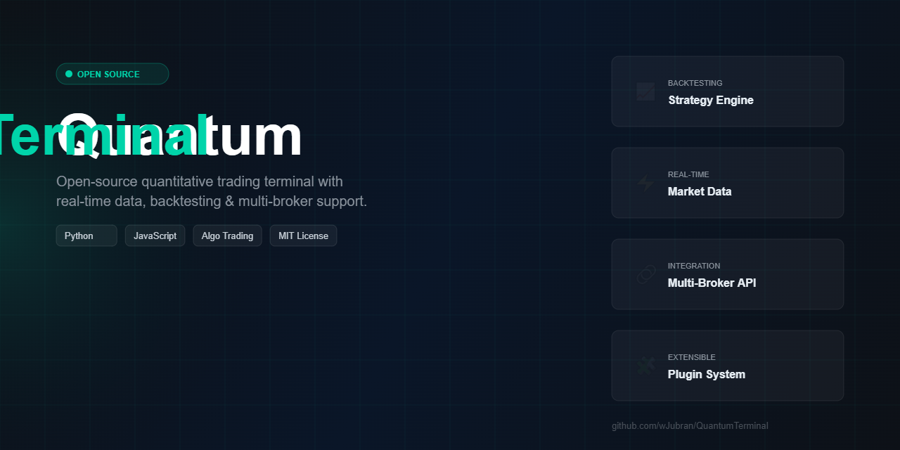
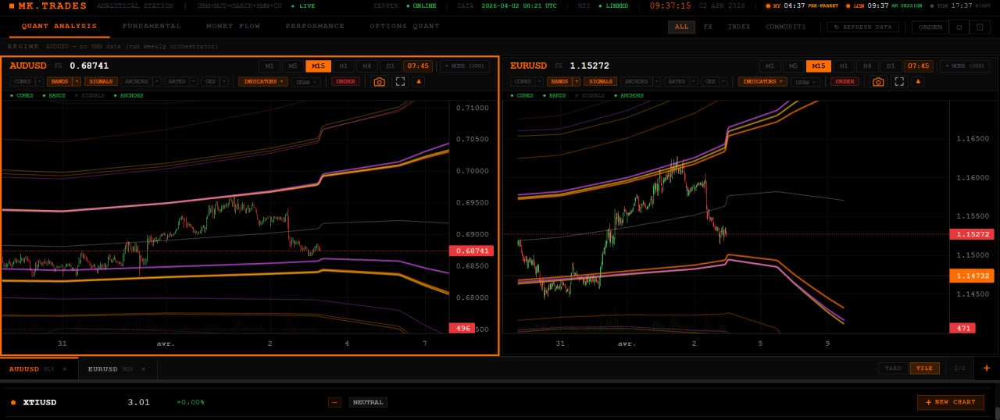

# 🌌 Quantum Terminal

<div align="center">
  <p><strong>A Next-Generation Open Source Trading & Quantitative Analysis Platform</strong></p>
  
  
  
  
  <a href="https://github.com/wJubran/QuantumTerminal/actions/workflows/ci.yml"></a>
</div>

---

## 📖 About The Project

**Quantum Terminal** is an advanced, fully free, and open-source trading terminal designed to bridge the gap between institutional-grade quantitative analysis and retail day trading. 

Unlike traditional platforms that rely on lagging indicators (like RSI or MACD), Quantum Terminal processes **real-time tick data** from professional brokerages and overlays complex mathematical probability models directly onto your charts. It acts as a localized display hub, separating heavy mathematical computations from real-time charting to ensure zero-latency trade monitoring.

---

## 📸 Screenshots

### Trading Interface — XAUUSD with Volatility Bands & Order Management


### Volatility Cones — Probability-Based Price Envelopes


---

## ✨ Core Features 

### 1. 🌐 Multi-Provider Live Feeds 
Quantum Terminal is built to handle ultra-fast data streams from the most reliable data providers in the industry:
- **MetaTrader 5 (MT5):** Direct integration via Python API for Forex, Crypto, and CFD markets.
- **Rithmic:** High-frequency, sub-millisecond tick processing for CME Futures (NQ, ES).
- **Tradovate:** Seamless integration for retail futures traders.
*(The platform features a dedicated `focus_tick_loop` ensuring the chart you are actively watching refreshes at maximum FPS without bottlenecking the system).*

### 2. 📐 Advanced Quantitative Models 
Move beyond simple support and resistance. The platform integrates institutional volatility models to forecast price action probabilities:
- **Volatility Cones:** Visualizing expected price ranges using Geometric Brownian Motion (**GBM**), Merton Jump Diffusion (**MJD**), and **Bates** models.
- **Scalp Bands & Micro Volatility:** Real-time bands designed specifically for high-frequency scalpers.
- **Probability Fields:** Heatmaps mapping the statistical likelihood of price reverting or trending.

### 3. 🌊 Options Flow & Market Maker Positioning 
Understanding where Market Makers are hedging is critical. Quantum Terminal visualizes:
- **Gamma Exposure (GEX):** Identifies sticky price levels and volatility triggers.
- **Max Pain:** Highlights the strike price with the most open options contracts.
- **Option Walls:** Visualizes heavy Call/Put resistance and support barriers.

### 4. 🌍 Macro Regime & Sector Rotation
Using data from `yfinance`, the terminal analyzes global market regimes:
- Tracks ETF Sector Rotation to see where smart money is flowing.
- Identifies the current market regime (Risk-On, Risk-Off, Inflationary, etc.) to align your trades with the broader macroeconomic trend.

### 5. 🧪 Simulated Market & Paper Trading (no broker needed)
Run the full terminal on **Windows, macOS or Linux** without MetaTrader 5 or a broker account — `python launcher.py --sim`:
- **Bates-model price engine:** stochastic volatility + jumps (the same model family as the volatility cones), with an intraday volatility profile (quiet Asia, busy London and New York opens).
- **Consistent across timeframes:** every timeframe aggregates the same minute bars, history never changes when re-requested, and live ticks always stay inside the current bar's high/low. Same seed → same market on every machine.
- **Paper trading:** market / limit / stop orders, SL/TP triggered by wicks between polls, partial closes, margin checks and USD P&L, saved across restarts.
- Clearly flagged as simulated: `/api/health` reports `"simulated": true` and the console banner says so. **Simulated prices are not market data.**

---

## 🏗️ Architecture & Repository Structure 

The project follows a decoupled architecture, ensuring the UI remains buttery smooth while the backend handles heavy lifting.

```text
QuantumTerminal/
├── backend/                # The Core Engine (Python/FastAPI)
│   ├── providers/          # MT5, Rithmic, Tradovate + simulated market (sim_provider.py)
│   ├── data_server.py      # Main FastAPI server and WebSocket broadcaster
│   ├── launcher.py         # Entry point: config, UI serving, CLI flags
│   ├── security.py         # Local API guard (cross-site / DNS-rebinding protection)
│   ├── mt5_safe.py         # Thread-safe MetaTrader5 access
│   └── tests/              # pytest suite (runs without MT5)
│
├── electron_shell/         # Desktop Application Wrapper
│   ├── main.js             # Electron main process
│   └── preload.js          # Security and IPC bridging
│
└── frontend_build/         # Compiled React UI
    ├── index.html          # Main entry point
    └── static/             # Minified JS/CSS for the charting interface
```

> **Note on Open Source:** The Python backend and Electron shell are fully open source. The React frontend is provided as a compiled production build (`frontend_build/`), meaning it is fully functional and ready to run, though the raw `.jsx` source files are not included in this repository.

---

## 🚀 Getting Started 

### Prerequisites
- **Python 3.10** or higher.
- **MetaTrader 5** on Windows (only for the live MT5 feed — not needed with `--sim`).
- `Node.js` (Optional, for the Electron desktop shell).

### Installation
1. Clone the repository:
   ```bash
   git clone https://github.com/wJubran/QuantumTerminal.git
   cd QuantumTerminal/backend
   ```
2. Install Python dependencies (the `MetaTrader5` package is installed on Windows only):
   ```bash
   pip install -r requirements.txt
   ```
3. Run the terminal:
   ```bash
   python launcher.py          # live feed from your MetaTrader 5 terminal
   python launcher.py --sim    # simulated market + paper trading, any OS
   ```
4. The terminal serves the UI on `http://127.0.0.1:8502` and opens your default browser. Click **CONTINUE TO TERMINAL** on the account screen — everything is unlocked, no sign-up.

### Options
| Flag | Environment variable | Purpose |
|------|----------------------|---------|
| `--sim` | `MK_PROVIDER=sim` | Simulated market data + paper trading account |
| `--port 8600` | `MK_PORT` | HTTP port (default `8502`) |
| `--no-browser` | `MK_NO_BROWSER=1` | Don't open the system browser |
| | `MK_FRONTEND_DIR` | Serve a different UI build |
| | `MK_ALLOWED_HOSTS` | Extra Host names allowed to reach the API (e.g. a LAN IP; `*` disables the check) |
| | `MK_CORS_ORIGINS` | Extra browser origins allowed to call the API (default: `http://localhost:3000`) |

The simulator's seed, starting balance and leverage live in `user_config.json` under `providers.accounts.sim_default`.

### Desktop app (Electron)
```bash
cd electron_shell
npm install
npm start            # or: npm run start:sim
```
The shell starts `backend/launcher.py` (using `.venv`/`venv` if present) and opens the terminal in a native window. Package it with Electron Forge or Electron Builder for distribution.

### Security
The backend only listens on `127.0.0.1`, and it rejects requests from other websites (Origin / `Sec-Fetch-Site` checks, including WebSocket handshakes) as well as DNS-rebinding attempts (Host header allow-list). A web page you visit therefore cannot place orders or read data through your running terminal.

### Running the tests
```bash
cd backend
pip install -r requirements-dev.txt
python -m pytest
```
The suite needs no broker: it runs the real API end-to-end on the simulated market. CI runs it on Linux and Windows for every pull request.

---

## 🛠️ Contributing 
This is a community-driven project! If you are a Python developer, Quant, or React engineer, your pull requests are welcome. 
- **Areas needing help:** adding new broker providers (like Interactive Brokers), a local quant engine that computes the cones/bands from bars (so the analysis panels fill without an external data server), and rebuilding an open-source React UI. See [CONTRIBUTING.md](CONTRIBUTING.md).

## ⚖️ Disclaimer
*Quantum Terminal is for educational and analytical purposes only. Trading financial markets carries a high level of risk and may not be suitable for all investors. The mathematical models provided by this software are probabilistic, not predictive. Prices produced by the simulated market (`--sim`) are synthetic and must never be used as market data.*

## 📄 License
This project is licensed under the **MIT License**. See the [LICENSE](LICENSE) file for more details.
