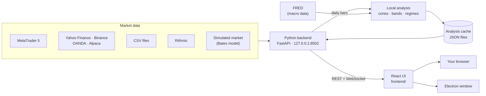

<div align="center">


# Quantum Terminal

**A free, open-source trading terminal that draws probability models —<br/>volatility cones, bands and options levels — on top of live charts.**

**English** · [العربية](README.ar.md)

[](https://github.com/wJubran/QuantumTerminal/releases/latest)
[](https://github.com/wJubran/QuantumTerminal/actions/workflows/ci.yml)
[](LICENSE)


<sub>Running on the built-in simulated market — the weekly volatility cones are computed by the terminal itself. No broker account needed.</sub>

</div>

<div dir="rtl">

> **بالعربية:** ‏Quantum Terminal منصة تداول مجانية ومفتوحة المصدر، ترسم فوق الشارت الحي المدى الذي يُرجَّح
> إحصائياً أن يتحرك فيه السعر، وتعمل على Windows وmacOS وLinux مع سوق محاكى مدمج لا يحتاج أي وسيط.
> **[اقرأ الشرح الكامل بالعربية، مع المتطلبات وطريقة التشغيل خطوة بخطوة ↓](#الشرح-بالعربية)**

</div>

---

## Why Quantum Terminal?

Most retail platforms are built around lagging indicators such as RSI or MACD. Quantum Terminal
shows the **range price is statistically expected to travel** instead: forecast cones from GBM,
Merton jump-diffusion (MJD) and Bates models, volatility bands and options-market levels (gamma
exposure, call/put walls, max pain), drawn right on the live candles.

It is a fast, local **display terminal**: heavy calculations run in the background, so the app
itself stays light — live charts, order entry and position management, all on your own computer.

## Quick start

If you already have **Python 3.10+**, four commands are enough. The simulated market works on Windows,
macOS and Linux:

```bash
git clone https://github.com/wJubran/QuantumTerminal.git
cd QuantumTerminal/backend
pip install -r requirements.txt
python launcher.py --sim
```

The terminal opens in your browser at **http://127.0.0.1:8502**. There is no sign-up, no licence
key and no paywall. For live prices without a broker, start with `python launcher.py --provider yahoo`
(forex, metals, energy, grains, indices, crypto) or `--provider binance` (crypto); see
[Data sources](#data-sources). New to Python, or want MetaTrader 5? Follow the
[step-by-step guide](#installation-step-by-step) below.

## Requirements

| | What you need | Notes |
|---|---|---|
| **Operating system** | Windows 10 or 11, macOS, or Linux (64-bit) | MetaTrader 5 needs Windows; the simulated market runs everywhere |
| **Python** | 3.10 or newer, 64-bit | Tested with 3.10, 3.12 and 3.13. On Windows, tick *Add python.exe to PATH* in the installer |
| **Memory** | 4 GB of RAM | The backend itself uses about 150 MB |
| **Disk space** | About 1 GB free | The Python packages take about 500 MB |
| **Browser** | A current Chrome, Edge, Firefox or Safari | Or use the desktop app instead |
| **Internet** | To install; afterwards for the live data sources, the macro regime (FRED) and the update check | The simulated market and CSV files work offline |
| **MetaTrader 5** *(optional)* | The MT5 desktop terminal from your broker, logged in to an account (a demo account is fine) | Windows only. One way to get real prices and place live orders; see [Data sources](#data-sources) for the others |
| **Node.js** *(optional)* | 20 or newer | Only for the desktop app or to rebuild the UI |
| **Git** *(optional)* | Any version | Or download the code as a ZIP file |

## Installation, step by step

### 1. Install Python

- **Windows:** download the 64-bit installer from [python.org](https://www.python.org/downloads/windows/)
  and tick **Add python.exe to PATH** on the first screen. Then open a new *Command Prompt* and check
  that `python --version` prints 3.10 or newer.
- **macOS:** use the installer from [python.org](https://www.python.org/downloads/macos/) or
  `brew install python@3.12`. On macOS and Linux, type `python3` wherever this guide says `python`.
- **Linux:** install your distribution's packages, e.g. `sudo apt install python3 python3-venv python3-pip`
  on Debian or Ubuntu.

### 2. Get the code

```bash
git clone https://github.com/wJubran/QuantumTerminal.git
cd QuantumTerminal
```

Without Git: on the repository page click **Code → Download ZIP**, extract it, and open a terminal in
the extracted folder (it may be called `QuantumTerminal-main`).

### 3. Create a virtual environment (recommended)

A virtual environment keeps the terminal's packages separate from the rest of your system. Create it
in the project folder, where the desktop app also looks for it:

```bat
:: Windows (Command Prompt)
python -m venv .venv
.venv\Scripts\activate
```

```bash
# macOS / Linux
python3 -m venv .venv
source .venv/bin/activate
```

Your prompt now starts with `(.venv)`. Activate it again in every new terminal window before you start
the terminal. If PowerShell refuses to run the activation script, run
`Set-ExecutionPolicy -Scope CurrentUser RemoteSigned` once, or use Command Prompt.

### 4. Install the dependencies

```bash
cd backend
pip install -r requirements.txt
```

The first install takes a few minutes. The `MetaTrader5` package is only installed on Windows,
because MetaQuotes publishes it for Windows only.

### 5. Start the terminal

**On the simulated market** (any system, no broker account):

```bash
python launcher.py --sim
```

**On live prices, without a broker** (any system, internet only):

```bash
python launcher.py --provider yahoo      # forex, metals, energy, grains, indices, crypto
python launcher.py --provider binance    # crypto, in real time
```

Orders then go to a paper account that fills them at those live prices. OANDA, Alpaca and CSV files are
set up in *Settings ⚙ → DATA SOURCES*; see [Data sources](#data-sources).

**With MetaTrader 5** (Windows):

1. Install MetaTrader 5 from your broker and log in to your account (a demo account is fine).
2. To place orders from Quantum Terminal, turn on **Algo Trading** in MetaTrader 5 (the toolbar
   button, or *Tools → Options → Expert Advisors → Allow algorithmic trading*).
3. Leave MetaTrader 5 running and start:

   ```bash
   python launcher.py
   ```

4. If the terminal does not find MetaTrader 5 on its own, set it under
   *Settings ⚙ → PROVIDERS*: **TERMINAL PATH** (the path to `terminal64.exe`) or
   **LOGIN CREDENTIALS** (server, login and password).

The launcher prints the server address and where it keeps its config, data (`AppData:`) and log file,
then opens **http://127.0.0.1:8502** in your browser. If the browser does not open, open that address
yourself. Keep the launcher window open while you use the terminal.

### 6. First steps in the terminal

- **Cones:** on a chart, open the ▾ next to **CONES** and pick DAILY, WEEKLY, MONTHLY or QUARTERLY (and
  **BATES** for the Bates model). The first time, they are ready about 30 seconds after start-up.
- **Trading:** orders are blocked until you switch on *Settings ⚙ → TRADING → LIVE TRADING*. On the
  simulator, and on the sources that only deliver prices, that switch only unlocks the paper account
  (100,000 USD, 1:100 leverage).
- **Data source:** *Settings ⚙ → DATA SOURCES* switches between MetaTrader 5, Yahoo Finance, Binance,
  OANDA, Alpaca, CSV files and the simulator while the terminal runs. The choice is remembered.
- **Learning Center:** the **LEARN** tab explains every page and model, in English and Arabic.

### 7. Stop, restart and update

- **Stop:** press `Ctrl+C` in the launcher window, or close it.
- **Restart:** open a terminal in the project folder, activate the virtual environment (step 3), then run
  `cd backend` and `python launcher.py` (add `--sim` for the simulated market).
- **Update:** in the project folder run `git pull`, then `pip install -r backend/requirements.txt` with the
  virtual environment active. Your settings and the paper account are kept: they live in the
  `AppData:` folder, not in the project folder.
- **Uninstall:** delete the project folder and the `AppData:` folder printed at start-up.

### Desktop app (optional)

With Node.js 20 or newer installed:

```bash
cd electron_shell
npm install
npm start              # or: npm run start:sim
```

The app starts the backend for you, using the project's `.venv` (or `venv`) when it exists and the
Python on your `PATH` otherwise, and shows the terminal in its own window. It keeps its settings in a
separate folder (`QuantumTerminal-v2`) from the browser version. Package it with Electron Forge or
electron-builder to distribute it.

### Troubleshooting

| Problem | What to do |
|---|---|
| `'python' is not recognized` (Windows) | Run the Python installer again and tick *Add python.exe to PATH*, or type `py` instead of `python` |
| `error while attempting to bind on address` | Port 8502 is in use, usually by another copy of the terminal. Close it, or start with `--port 8600` |
| No `MetaTrader5` package on macOS or Linux | Expected: it exists for Windows only. Use `--sim` |
| `MT5 initialize() failed` in the log | Check that MetaTrader 5 is open and logged in, and set TERMINAL PATH under *Settings ⚙ → PROVIDERS* |
| MetaTrader 5 rejects orders because algo trading is disabled | Turn on **Algo Trading** in MetaTrader 5 |
| The browser did not open, or the page stays empty | Open http://127.0.0.1:8502 yourself, and look at the log file the launcher printed |
| No cones on the chart | Wait about 30 seconds after the first start, then turn them on from the ▾ next to **CONES** |
| A ticker stays empty on Yahoo Finance, OANDA, Binance or Alpaca | The source knows it under another name: set its broker symbol under *Settings ⚙ → UNIVERSE* ([ticker names](#ticker-names)) |
| **TEST** in DATA SOURCES says 401 or 403 | The token or API key is wrong or has expired, or a practice token is being used on live (or the other way round) |
| **TEST** cannot reach the source | Allow its address in your firewall or proxy: `query1.finance.yahoo.com`, `api.binance.com`, `api-fxpractice.oanda.com` (`api-fxtrade.oanda.com` for live) or `data.alpaca.markets` |

## Features

### Works out of the box

| Area | What you get |
|---|---|
| **Volatility cones** | DAILY, WEEKLY, MONTHLY and QUARTERLY cones from GBM, MJD and Bates models, computed by the terminal from the feed's own daily bars ([how](#how-the-cones-are-computed)) |
| **Probability bands** | Rolling GBM, MJD and Bates bands that restart at every trading day's open, with their width taken from the last 60 trading days and a 20-day forward fan ([how](#how-the-bands-are-computed)) |
| **Replay** | Plays back past weekly, monthly and quarterly cones and the daily bands against price, bar by bar |
| **Pulse Room** | Scanner that ranks your watchlist by where price sits inside its cones and bands |
| **Regimes** | Each instrument's volatility regime (calm → stressed) from a walk-forward HMM, a 15-minute volatility alarm, and the macro growth/inflation quadrant from FRED data ([how](#how-the-regimes-are-computed)) |
| **Live charts** | TradingView Lightweight Charts, M1 to D1, several charts in tabs, drawing tools, chart templates, crosshair price/time readout, world clock with trading sessions |
| **Order entry** | Market, limit and stop orders with stop loss / take profit, and a live risk / reward preview in money and in % of the balance |
| **Positions** | Open positions with risk, reward and P&L; drag SL/TP lines on the chart, or edit and close from the table; account exposure strip |
| **Data sources** | MetaTrader 5, Yahoo Finance, Binance, OANDA, Alpaca, CSV files and Rithmic futures data (optional `async_rithmic` package), switched while the terminal runs ([details](#data-sources)) |
| **Paper trading on live prices** | Practise on any data source: a paper account fills your orders at its live bid/ask, and SL/TP trigger on wicks |
| **Simulated market** | Bates-model prices (stochastic volatility + jumps) with an intraday rhythm, consistent across timeframes and reproducible from a seed; paper account with margin checks and SL/TP that trigger on wicks |
| **Learning Center** | Bilingual (English / العربية) guide to the terminal, the quant models (GBM, MJD, Bates, GEX), trade setups and keyboard shortcuts |
| **Desktop app** | Optional Electron shell that starts the backend and opens the terminal in its own window |
| **Safety** | Trading switch off by default and enforced by the server, local-only server, protection against cross-site requests and DNS rebinding, API keys never sent back to the browser |

### Analysis overlays — need pre-computed data

| Panel | What it shows |
|---|---|
| **Options Quant** | Gamma exposure (GEX), call/put walls, max pain and dealer positioning |
| **Fundamental · Money Flow** | Macro dashboard, and sector, country and asset-class rotation |
| **Options Cockpit** | The options view in Stress Lab |

These panels read pre-computed analysis files from the same local cache the cones and bands are written
to. **This repository does not produce them yet**, so out of the box they stay empty, and the header
shows `SERVER ○ NONE` because no data server is configured. Extending the local engine to options
levels and the macro pages is the top item on the [roadmap](#roadmap).

## Data sources

Prices can come from seven sources. Pick one in *Settings ⚙ → DATA SOURCES* while the terminal runs
(**SETTINGS**, **TEST**, **USE**), or start with `python launcher.py --provider <type>`. MetaTrader 5
and OANDA also take your orders. The other sources only deliver prices, so they trade on the **paper
account**, which fills orders at that source's live bid and ask.

| Source | `--provider` | Markets | Prices | Needs | Orders go to |
|---|---|---|---|---|---|
| **MetaTrader 5** | `mt5` | Everything your broker offers | Real time | Windows, the MT5 terminal, a broker account (demo is fine) | MT5 |
| **OANDA** | `oanda` | Forex; gold, silver, platinum, oil, natural gas, copper, corn, wheat, soybeans, sugar; index CFDs | Real time | A free practice account and an API token | OANDA |
| **Yahoo Finance** | `yahoo` | Forex; metals, energy, grain, soft and livestock futures; indices, stocks, ETFs, crypto | Delayed for some markets (futures ≈ 10 min) | Nothing: free, no account | Paper account |
| **Binance** | `binance` | Crypto | Real time | Nothing: free, no account | Paper account |
| **Alpaca** | `alpaca` | US stocks and ETFs (including GLD, SLV, USO, UNG, CPER), crypto | Real time (IEX) | A free account and an API key | Paper account |
| **CSV files** | `csv` | Anything you have bars for | From the files | Files in a folder | Paper account |
| **Simulated market** | `sim` | The default tickers, with synthetic prices | Generated | Nothing, works offline | The simulator's paper account |

When you switch, the charts reload, and the cones and bands are rebuilt from the new source's daily bars
within a minute or two. The header shows the active source: `MT5 ● LINKED`, `FEED ● YAHOO`,
`FEED ● BINANCE` and so on.

### Setting up each source

**Yahoo Finance.** There is nothing to set up. Quotes refresh every 30 seconds (*Quote refresh*; lower
it at the risk of Yahoo's rate limit). A quote is the last trade price, so paper orders on Yahoo Finance
fill without a spread. Metals, energy and US
indices are quoted as front-month futures (gold is `GC=F`), so their levels differ slightly from spot or
CFD prices. History goes back about 7 days for 1-minute bars, 60 days for 5- to 30-minute bars, 2 years
for hourly bars and decades for daily bars.

**Binance.** There is nothing to set up. `BTCUSD` is read as `BTCUSDT` (change *Quote asset* for USDC or
FDUSD). If `api.binance.com` is not reachable where you are, as in the US, pick `https://api.binance.us`
or the market-data-only `https://data-api.binance.vision` as *API address*.

**OANDA:**

1. Open a free practice account at [oanda.com](https://www.oanda.com).
2. In the OANDA hub, open *My Account → Manage API Access* and generate a token.
3. In *Settings ⚙ → DATA SOURCES → OANDA → SETTINGS*, choose the `practice` environment, paste the
   token, and leave *Account ID* empty to use your first account. Then press **SAVE**, **TEST** and **USE**.

Orders then go to that OANDA account once LIVE TRADING is on. Daily bars start at the 17:00 New York
roll, as on MetaTrader 5 forex brokers.

**Alpaca:**

1. Create a free account at [alpaca.markets](https://alpaca.markets). A paper-only account is enough.
2. In the dashboard, generate an API key and copy the key ID and the secret. The secret is shown only once.
3. In *Settings ⚙ → DATA SOURCES → Alpaca → SETTINGS*, paste both. *Feed* `iex` is free; `sip` covers
   every US exchange and needs a paid plan. Then press **SAVE**, **TEST** and **USE**.

**CSV files.** Put the files in the CSV folder, which by default is `csv` inside the `AppData:` folder.
Name them `XAUUSD_M15.csv`, `XAUUSD_D1.csv`, or just `XAUUSD.csv`. The columns are found by name:

- `date` and `time`, in one column or two;
- `open`, `high`, `low` and `close`;
- `volume`, which is optional.

Comma, semicolon and tab delimiters, most date formats and Unix time are recognized, so exports from
MetaTrader 5, TradingView or NinjaTrader work as they are. A missing timeframe is built from a shorter
one (H1 bars from M15, for example). For cones and bands, provide at least about a year of daily bars. The ticker must also be in your
UNIVERSE list.

**Keys without the Settings panel.** The terminal also reads the environment variables `OANDA_TOKEN`,
`OANDA_ACCOUNT_ID`, `APCA_API_KEY_ID` and `APCA_API_SECRET_KEY`. Keys stay on your computer, in
`user_config.json` in the `AppData:` folder. They are sent only to that source's own API, and the
Settings panel shows them as `••••••`.

### Ticker names

The terminal uses one name per instrument, and each source translates it:

| Terminal | Yahoo Finance | OANDA | Binance | Alpaca |
|---|---|---|---|---|
| `EURUSD` | `EURUSD=X` | `EUR_USD` | — | — |
| `XAUUSD` | `GC=F` | `XAU_USD` | — | — |
| `XTIUSD` | `CL=F` | `WTICO_USD` | — | — |
| `NATGAS` | `NG=F` | `NATGAS_USD` | — | — |
| `CORN` | `ZC=F` | `CORN_USD` | — | — |
| `US500` | `ES=F` | `SPX500_USD` | — | — |
| `BTCUSD` | `BTC-USD` | `BTC_USD` | `BTCUSDT` | `BTC/USD` |

Add commodities under *Settings ⚙ → UNIVERSE* with the CMDTY class. Yahoo Finance knows `XAGUSD`,
`XPTUSD`, `XBRUSD`, `COPPER`, `WHEAT`, `SOYBEAN`, `COFFEE`, `SUGAR`, `COCOA` and `COTTON` as they are, and
OANDA all of them but coffee, cocoa and cotton. A ticker that
stays empty is not known to that source under that name: set its *broker symbol* in UNIVERSE to the
source's own name, for example `ZO=F` for oats on Yahoo Finance. For a mapping that applies to one
source only, add it to `providers.accounts.<id>.symbols` in `user_config.json`, for example
`"symbols": {"US500": "SPX500_USD"}`.

### The paper account on live prices

- It starts with 100,000 USD at 1:100 leverage. Both can be changed in the execution-account box of DATA
  SOURCES, and **RESET** starts the account over.
- It supports market, limit and stop orders, stop loss and take profit, partial closes and margin checks,
  with P&L converted to USD. The account is saved in `paper_account.json`.
- Stop loss and take profit trigger on wicks. The terminal checks every quote it saw and the source's
  1-minute bars, but never a price from before the order existed.
- As with every account, orders wait for *Settings ⚙ → TRADING → LIVE TRADING*.

## Screenshots

<table>
  <tr>
    <td width="50%"></td>
    <td width="50%"></td>
  </tr>
  <tr>
    <td align="center"><sub>Order ticket with a live risk / reward preview (paper account)</sub></td>
    <td align="center"><sub>The Learning Center in Arabic</sub></td>
  </tr>
  <tr>
    <td width="50%"></td>
    <td width="50%"></td>
  </tr>
  <tr>
    <td align="center"><sub>Volatility cones with drift-based TP / entry / SL levels</sub></td>
    <td align="center"><sub>Cones and bands on two charts</sub></td>
  </tr>
</table>

<sub>The last two images were rendered from pre-computed analysis data, which is not part of this repository.</sub>

## How the cones are computed

A few seconds after start-up, and again whenever a new daily bar appears, the terminal rebuilds every
instrument's cones from the active feed's daily bars (`backend/local_analysis/`):

- **Anchors:** each cone starts at the open of its period — the trading day, the week (Monday), the
  month or the quarter — and runs to the end of that period. The chart also shows the previous
  periods' cones, so you can see how past forecasts played out.
- **No look-ahead:** a cone's parameters come only from the ~250 daily returns *before* its anchor.
- **Models:** GBM (normal returns, closed form); MJD (GBM plus Poisson jumps, fitted from the days that
  stand out against the volatility of their time; exact mixture quantiles); Bates (Heston stochastic variance plus the same jumps, 25,000 Monte Carlo
  paths with a fixed seed, so results are reproducible).
- **Lines:** the median and the ±1, ±2 and ±3 standard-deviation quantiles (p15.9 / p84.1,
  p2.3 / p97.7, p0.13 / p99.87), with a zero expected log return.
- **Trading time:** time advances only on the weekdays the instrument actually trades, read from its
  own bars, so a cone does not widen over a closed weekend.

The results are written to the analysis cache as `{TICKER}_cones.json` and
`{TICKER}_quarterly_cones.json` (eight quarters: the chart shows four, the **REPLAY** page all eight), and
the past weekly and monthly cones the **REPLAY** page plays back as `{TICKER}_historical_cones.json`. A
file another producer wrote is never overwritten. Turn the cones on from the ▾ next to **CONES** (and
**BATES**) on a chart; `MK_LOCAL_ANALYSIS=0` turns the computation off.

## How the bands are computed

A cone is one forecast per period. The bands start again every trading day, so they follow the price:

- **Anchor:** every trading day's open. The forecast uses only the returns before it.
- **Width:** the volatility of the last **60 trading days**, leaving out jump days. The tails keep the
  cones' long-run shape: MJD's jumps, and Bates' long-run variance, vol of vol and correlation, all from
  ~250 days. So the bands react to a change in volatility within weeks.
- **History:** one point per day, half a trading day after the open, at that horizon's ±1/2/3-sigma
  quantiles. The chart joins and smooths these points into the envelope.
- **Forward fan:** the newest day is projected 20 trading days ahead.
- **Centre line:** the anchor price, shared by the three models, which all have a zero expected log return.

They are written as `{TICKER}_bands.json` (chart, Pulse Room), and every day's forward fan as
`{TICKER}_bands_replay.json` for the **REPLAY** page. Turn them on with **BANDS** on a chart, or the **B**
key, and pick GBM, MJD or BATES from its ▾.

## How the regimes are computed

The **REGIMES** strip above the chart has two readings, both computed by the terminal
(`backend/local_analysis/regimes.py`):

- **MICRO, the instrument's own regime.** A hidden Markov model reads each day's return and the
  realized volatility of the last 5 days, from the active feed's daily bars.
  - It uses 2 to 4 states, chosen by BIC and ordered from *calm* to *stressed* by their volatility.
  - **Walk-forward, no look-ahead:** the model is refitted every month on up to four years of history, and
    each day is labelled with the filtered probabilities of a model fitted before it. The shading shows
    what the strip would have shown on each day.
  - The pill shows the regime expected for today, from the last completed day, and its probability.
- **⚠ IMMINENT, the 15-minute volatility alarm.**
  - The last 2,000 15-minute returns are divided by the usual size of moves at that time of day, so the
    New York open is not mistaken for a regime.
  - A two-state model (normal / burst) then forecasts the volatility of the next two hours.
  - IMMINENT appears when that forecast is at least 1.5 times the usual for those hours. Otherwise the chip
    shows QUIET and the minutes since the last alarm.
- **MACRO, the economy's quadrant.**
  - **Growth** is the 3-month change of the S&P 500.
  - **Inflation** is the 3-month change of the 10-year breakeven rate and of WTI crude.
  - Each is measured against its typical size over the last three years.
  - A four-state HMM pinned to the corners turns them into GOLDILOCKS (growth up, inflation down),
    REFLATION (both up), STAGFLATION (growth down, inflation up) or DEFLATION (both down).
  - The series come from FRED, free and without a key, so MACRO needs internet access to
    `fred.stlouisfed.org`.

The results are written as `{TICKER}_regime.json` and `GLOBAL_macro_regime.json`. The daily part is
rebuilt once per trading day and the alarm with every new 15-minute bar. Turn the shading on with
**MACRO** or **MICRO** above the chart; the ▾ next to each sets the opacity, hides states or paints the
candles.

## How it works



The backend talks to the active data source through a common provider interface, sends orders to the
execution account (MetaTrader 5, OANDA or a paper account), streams prices to the UI over WebSockets,
computes the cones, bands and regimes in the background and serves the analysis cache over REST. The UI
is a React 18 app; its production build is committed in `frontend_build/`, so running the terminal never
requires Node.js.

```text
QuantumTerminal/
├── backend/                 Python backend (FastAPI)
│   ├── launcher.py          entry point: config, UI serving, command-line options
│   ├── data_server.py       REST API + WebSocket price streams
│   ├── providers/           data sources (MT5, Yahoo, Binance, OANDA, Alpaca, CSV, Rithmic), simulator, paper account
│   ├── local_analysis/      cones, bands, regimes and Replay files from the feed's bars
│   ├── security.py          local-only API guard (cross-site / DNS-rebinding protection)
│   └── tests/               pytest suite — runs without a broker
├── frontend/                React source of the UI (Create React App)
├── frontend_build/          production build served by the backend
├── electron_shell/          optional desktop app
└── screenshots/
```

## Configuration

| Option | Environment variable | What it does |
|--------|----------------------|--------------|
| `--sim` | `MK_PROVIDER=sim` | Simulated market data + paper trading account |
| `--provider yahoo` | `MK_PROVIDER=yahoo` | Data source for this run: `mt5`, `sim`, `yahoo`, `binance`, `oanda`, `alpaca` or `csv` |
| | `OANDA_TOKEN`, `OANDA_ACCOUNT_ID` | OANDA API token and account, instead of entering them in Settings |
| | `APCA_API_KEY_ID`, `APCA_API_SECRET_KEY` | Alpaca API key pair, instead of entering it in Settings |
| `--port 8600` | `MK_PORT` | HTTP port (default `8502`) |
| `--no-browser` | `MK_NO_BROWSER=1` | Don't open the system browser |
| | `MK_UPDATE_CHECK=0` | Don't check GitHub for a newer release (the answer is cached for 10 minutes) |
| | `MK_LOCAL_ANALYSIS=0` | Don't compute the cones, bands and regimes locally |
| | `MK_FRONTEND_DIR` | Serve a different UI build |
| | `MK_ALLOWED_HOSTS` | Extra host names allowed to reach the API, e.g. a LAN address (`*` disables the check) |
| | `MK_CORS_ORIGINS` | Extra browser origins allowed to call the API (default: `http://localhost:3000`) |

Your settings are saved in `user_config.json` in the folder printed as `AppData:` when the terminal
starts. Each source's settings are under `providers.accounts.<id>` (`yahoo_default`, `binance_default`,
`oanda_default`, `alpaca_default`, `csv_default`); the simulator's seed, starting balance and leverage
are under `sim_default`, and the paper account's under `paper_default`.

## Development

- **Backend** — `cd backend && pip install -r requirements-dev.txt && python -m pytest`. The suite
  runs the real API end-to-end on the simulated market, so it needs no broker.
- **UI** — the React source lives in [`frontend/`](frontend/README.md): `npm ci && npm start` gives
  hot reload against a running backend. Run `npm run build` and commit `frontend_build/` together
  with your source change.
- **CI** runs the tests on Linux and Windows with Python 3.10 and 3.12, rebuilds the UI to check that
  `frontend_build/` matches the source, and checks the Electron shell.

See [CONTRIBUTING.md](CONTRIBUTING.md) for the workflow, and [CHANGELOG.md](CHANGELOG.md) for what changed in each release.

## Security

The backend listens on `127.0.0.1` only. It rejects requests from other websites (Origin and
`Sec-Fetch-Site` checks, WebSocket handshakes included) and DNS-rebinding attempts (Host header
allow-list), so a web page you visit cannot place orders or read data through your running terminal.
Orders are blocked until you switch trading on, and the server refuses them too. API tokens and
secrets are sent only to their data source and never back to the browser. Calls into MetaTrader 5 are
serialized.

Found a vulnerability? Please report it privately; see [SECURITY.md](SECURITY.md).

## Roadmap

- **Local quant engine, next steps** — the cones, bands and regimes are computed locally; options levels
  and the macro pages are next, so every panel works without a data server.
- **More brokers** — Interactive Brokers, and orders on Alpaca, through the provider interface. A
  data source is about 100 lines: see `providers/binance_provider.py`.
- **Translations** — the Learning Center already supports English and Arabic; the rest of the UI is
  English for now.
- **Packaged releases** — signed desktop installers.

Contributions are welcome — see [CONTRIBUTING.md](CONTRIBUTING.md).

## Disclaimer

Quantum Terminal is for education and analysis. Trading financial markets carries a high risk of
loss and is not suitable for everyone. The models are probabilistic, not predictive. Prices from the
simulated market (`--sim`) are synthetic and must never be used as market data. Prices from Yahoo
Finance may be delayed.

---

<div dir="rtl">

## الشرح بالعربية

### ما هي Quantum Terminal؟

منصة تداول **مجانية ومفتوحة المصدر** تعمل على جهازك أنت. معظم منصات الأفراد مبنية حول مؤشرات متأخرة
مثل RSI وMACD، أما Quantum Terminal فترسم فوق الشموع الحية **المدى الذي يُرجَّح إحصائياً أن يتحرك فيه
السعر**: نطاقات توقّع (volatility cones) من نماذج GBM وMJD وBates، تحسبها المنصة بنفسها من بيانات السوق.
ومعها شارت حي، وإدخال أوامر مع وقف الخسارة وجني الربح، وإدارة للصفقات، وسوق محاكى كامل بحساب تداول
ورقي لتجرّب كل شيء دون أي وسيط ودون أي مخاطرة. لا تسجيل حساب، ولا مفتاح ترخيص، ولا اشتراك مدفوع.

### أبرز المزايا

- **الـ volatility cones:** يومية وأسبوعية وشهرية وفصلية بثلاثة نماذج (GBM وMJD وBates)، تُحسب من الشموع
  اليومية لمصدر البيانات نفسه، دون النظر إلى المستقبل، وتتحدّث تلقائياً مع كل شمعة يومية جديدة.
- **الـ bands الاحتمالية:** تبدأ من جديد عند افتتاح كل يوم تداول ويُحسب اتساعها من آخر 60 يوم تداول،
  فتتحرك مع السعر، مع توقّع لـ 20 يوم تداول قادمة. وصفحة REPLAY تعيد عرض الـ cones والـ bands السابقة
  أمام حركة السعر شمعة بشمعة.
- **الـ Regimes:** حالة التقلب لكل أداة من الهدوء (calm) إلى الضغط (stressed)، وتنبيه IMMINENT عند توقّع
  انفجار في التقلب خلال ساعتين، وربع الاقتصاد الكلي (GOLDILOCKS وREFLATION وSTAGFLATION وDEFLATION) من
  بيانات FRED، وكلها دون النظر إلى المستقبل.
- **شارت حي:** من M1 إلى D1، عدة شارتات في تبويبات، أدوات رسم، قوالب، وساعة عالمية بجلسات التداول.
- **الأوامر والصفقات:** أوامر market وlimit وstop مع SL/TP، ومعاينة فورية للمخاطرة والعائد، وسحب خطوط
  SL/TP على الشارت.
- **السوق المحاكى:** أسعار من نموذج Bates متسقة بين كل الأطر الزمنية، وحساب ورقي برصيد 100,000 دولار.
- **مصادر البيانات:** MetaTrader 5 وYahoo Finance وBinance وOANDA وAlpaca وملفات CSV، مع التبديل بينها
  أثناء عمل المنصة، وحساب ورقي يتداول على الأسعار الحية لأي منها.
- **السلع:** الذهب والفضة والبلاتين والنفط والغاز الطبيعي والنحاس، والحبوب والسكر والقهوة والكاكاو والقطن،
  عبر MetaTrader 5 أو OANDA أو عقود futures من Yahoo Finance.
- **مركز التعلم:** دليل كامل بالعربية والإنجليزية داخل المنصة.
- **الأمان:** السيرفر محلي فقط، ولا تستطيع أي صفحة ويب تزورها إرسال أوامر عبر منصتك، ومفاتيح الـ API لا
  تغادر جهازك إلا إلى مصدرها.

لوحات Options Quant وFundamental وMoney Flow تحتاج بيانات تحليل محسوبة مسبقاً لا ينتجها المستودع بعد،
فتبقى فارغة حالياً. التفاصيل في [النسخة العربية الكاملة](README.ar.md).

### المتطلبات

| | المطلوب | ملاحظات |
|---|---|---|
| **نظام التشغيل** | Windows 10 أو 11، أو macOS، أو Linux بنظام 64 بت | MetaTrader 5 يحتاج Windows، أما السوق المحاكى فيعمل على الأنظمة الثلاثة |
| **Python** | الإصدار 3.10 أو أحدث، بنسخة 64 بت | جُرّبت المنصة على 3.10 و3.12 و3.13. على Windows فعّل خيار <code dir="ltr">Add python.exe to PATH</code> أثناء التثبيت |
| **الذاكرة** | ذاكرة بسعة 4 غيغابايت | الـ backend نفسه يستهلك نحو 150 ميغابايت |
| **مساحة القرص** | نحو 1 غيغابايت فارغة | حزم Python تأخذ نحو 500 ميغابايت |
| **المتصفح** | نسخة حديثة من Chrome أو Edge أو Firefox أو Safari | أو استخدم تطبيق سطح المكتب بدلاً منه |
| **الإنترنت** | للتثبيت، ثم لمصادر البيانات الحية والـ regime الكلي (FRED) والتحقق من التحديثات | السوق المحاكى وملفات CSV تعمل دون إنترنت |
| **MetaTrader 5** ‏(اختياري) | منصة MT5 من وسيطك، مع تسجيل الدخول إلى حساب (الحساب التجريبي يكفي) | على Windows فقط، وهي إحدى طرق الحصول على أسعار حقيقية وإرسال أوامر حية، والطرق الأخرى في [مصادر البيانات](#مصادر-البيانات) |
| **Node.js** ‏(اختياري) | الإصدار 20 أو أحدث | فقط لتطبيق سطح المكتب أو لإعادة بناء الواجهة |
| **Git** ‏(اختياري) | أي إصدار | أو حمّل الكود كملف ZIP |

### التثبيت والتشغيل خطوة بخطوة

#### 1. ثبّت Python

- **على Windows:** حمّل مثبّت نسخة 64 بت من [python.org](https://www.python.org/downloads/windows/)،
  وفعّل خيار **Add python.exe to PATH** في الشاشة الأولى. ثم افتح نافذة *Command Prompt* جديدة وتأكد أن
  الأمر <code dir="ltr">python --version</code> يُظهر 3.10 أو أحدث.
- **على macOS:** استخدم المثبّت من [python.org](https://www.python.org/downloads/macos/) أو الأمر
  <code dir="ltr">brew install python@3.12</code>. وعلى macOS وLinux اكتب <code dir="ltr">python3</code>
  أينما ذُكر <code dir="ltr">python</code> في هذا الدليل.
- **على Linux:** ثبّت حزم توزيعتك، فعلى Debian وUbuntu مثلاً نفّذ الأمر
  <code dir="ltr">sudo apt install python3 python3-venv python3-pip</code> في نافذة الأوامر.

#### 2. احصل على الكود

</div>

```bash
git clone https://github.com/wJubran/QuantumTerminal.git
cd QuantumTerminal
```

<div dir="rtl">

بدون Git: من صفحة المستودع اضغط **Code ← Download ZIP**، وفُكّ الضغط، ثم افتح نافذة الأوامر داخل المجلد
الناتج، وقد يكون اسمه <code dir="ltr">QuantumTerminal-main</code> بعد فك الضغط.

#### 3. أنشئ بيئة افتراضية (مُستحسن)

البيئة الافتراضية (virtual environment) تعزل حزم المنصة عن بقية النظام. أنشئها داخل مجلد المشروع، فهناك
يبحث عنها تطبيق سطح المكتب أيضاً:

</div>

```bat
:: Windows (Command Prompt)
python -m venv .venv
.venv\Scripts\activate
```

```bash
# macOS / Linux
python3 -m venv .venv
source .venv/bin/activate
```

<div dir="rtl">

سيبدأ سطر الأوامر الآن بـ <code dir="ltr">(.venv)</code>. فعّل البيئة من جديد في كل نافذة أوامر جديدة قبل
تشغيل المنصة. وإذا رفض PowerShell تشغيل سكربت التفعيل، فنفّذ مرة واحدة الأمر
<code dir="ltr">Set-ExecutionPolicy -Scope CurrentUser RemoteSigned</code>، أو استخدم نافذة Command Prompt بدلاً منه.

#### 4. ثبّت المكتبات المطلوبة

</div>

```bash
cd backend
pip install -r requirements.txt
```

<div dir="rtl">

يستغرق التثبيت الأول بضع دقائق. حزمة <code dir="ltr">MetaTrader5</code> تُثبَّت على Windows فقط، لأن
شركة MetaQuotes لا تنشرها إلا لنظام Windows وحده.

#### 5. شغّل المنصة

**على السوق المحاكى** (أي نظام، دون حساب لدى وسيط):

</div>

```bash
python launcher.py --sim
```

<div dir="rtl">

**على أسعار حية، بدون وسيط** (أي نظام، ويكفي الاتصال بالإنترنت):

</div>

```bash
python launcher.py --provider yahoo      # forex, metals, energy, grains, indices, crypto
python launcher.py --provider binance    # crypto, in real time
```

<div dir="rtl">

بعدها تذهب الأوامر إلى حساب ورقي ينفّذها بتلك الأسعار الحية. أما OANDA وAlpaca وملفات CSV فتُعدّ من
*الإعدادات ⚙ ← DATA SOURCES*، والتفاصيل في [مصادر البيانات](#مصادر-البيانات).

**مع MetaTrader 5** (على Windows):

1. ثبّت MetaTrader 5 من وسيطك وسجّل الدخول إلى حسابك (الحساب التجريبي يكفي).
2. لتتمكن من إرسال الأوامر من Quantum Terminal، فعّل **Algo Trading** في MetaTrader 5 من زره في شريط الأدوات،
   أو من القائمة <code dir="ltr">Tools → Options → Expert Advisors</code> بتفعيل الخيار
   <code dir="ltr">Allow algorithmic trading</code> فيها.
3. اترك MetaTrader 5 مفتوحاً وشغّل الأمر: <code dir="ltr">python launcher.py</code>
4. إذا لم تعثر المنصة على MetaTrader 5 تلقائياً، فاضبطه من *الإعدادات ⚙ ← PROVIDERS*: إما
   **TERMINAL PATH** (مسار الملف <code dir="ltr">terminal64.exe</code>) أو **LOGIN CREDENTIALS** (السيرفر ورقم
   الحساب وكلمة المرور).

يطبع المشغّل عنوان السيرفر وأماكن ملف الإعدادات والبيانات (<code dir="ltr">AppData:</code>) وملف السجل،
ثم يفتح العنوان **http://127.0.0.1:8502** في متصفحك. إذا لم يُفتح المتصفح فافتح العنوان بنفسك. واترك نافذة
المشغّل مفتوحة طوال استخدامك للمنصة.

#### 6. أول خطوات داخل المنصة

- **الـ cones:** على الشارت افتح السهم ▾ بجانب **CONES** واختر DAILY أو WEEKLY أو MONTHLY أو QUARTERLY،
  ومنه أيضاً **BATES** لعرض نموذج Bates. في المرة الأولى تكون جاهزة بعد التشغيل بنحو 30 ثانية.
- **التداول:** الأوامر محظورة إلى أن تفعّل *الإعدادات ⚙ ← TRADING ← LIVE TRADING*. وفي المحاكي، وفي
  المصادر التي تقدّم الأسعار فقط، يفتح هذا المفتاح الحساب الورقي فقط (100,000 دولار برافعة 1:100).
- **مصدر البيانات:** من *الإعدادات ⚙ ← DATA SOURCES* تنتقل بين MetaTrader 5 وYahoo Finance وBinance وOANDA
  وAlpaca وملفات CSV والمحاكي أثناء عمل المنصة، وتتذكر المنصة اختيارك.
- **مركز التعلم:** تبويب **LEARN** يشرح كل صفحة وكل نموذج، بالعربية والإنجليزية.

#### 7. الإيقاف وإعادة التشغيل والتحديث

- **الإيقاف:** اضغط <code dir="ltr">Ctrl+C</code> في نافذة المشغّل، أو أغلقها.
- **إعادة التشغيل:** افتح نافذة أوامر داخل مجلد المشروع، وفعّل البيئة الافتراضية (الخطوة 3)، ثم نفّذ
  <code dir="ltr">cd backend</code> و<code dir="ltr">python launcher.py</code> (وأضف
  <code dir="ltr">--sim</code> للسوق المحاكى).
- **التحديث:** داخل مجلد المشروع نفّذ <code dir="ltr">git pull</code>، ثم
  <code dir="ltr">pip install -r backend/requirements.txt</code> والبيئة الافتراضية مفعّلة. تبقى إعداداتك
  والحساب الورقي كما هي، لأنها محفوظة في مجلد <code dir="ltr">AppData:</code> لا في مجلد المشروع.
- **إزالة المنصة:** احذف مجلد المشروع ومجلد <code dir="ltr">AppData:</code> الذي يظهر عند التشغيل.

#### تطبيق سطح المكتب (اختياري)

بعد تثبيت Node.js بالإصدار 20 أو أحدث:

</div>

```bash
cd electron_shell
npm install
npm start              # or: npm run start:sim
```

<div dir="rtl">

يشغّل التطبيق الـ backend تلقائياً، مستخدماً البيئة <code dir="ltr">.venv</code> أو
<code dir="ltr">venv</code> في مجلد المشروع إن وُجدت، وإلا فـ Python المثبّت على الجهاز، ويعرض المنصة في
نافذة مستقلة. ويحفظ إعداداته في مجلد خاص به اسمه <code dir="ltr">QuantumTerminal-v2</code>، منفصل عن إعدادات نسخة المتصفح.

#### حل المشكلات الشائعة

| المشكلة | الحل |
|---|---|
| رسالة <code dir="ltr">'python' is not recognized</code> على Windows | شغّل مثبّت Python مجدداً وفعّل <code dir="ltr">Add python.exe to PATH</code>، أو اكتب <code dir="ltr">py</code> بدلاً من <code dir="ltr">python</code> |
| رسالة <code dir="ltr">error while attempting to bind on address</code> | المنفذ 8502 مستخدم، غالباً بنسخة أخرى من المنصة. أغلقها، أو شغّل المنصة على منفذ آخر بإضافة <code dir="ltr">--port 8600</code> إلى الأمر |
| لا توجد حزمة <code dir="ltr">MetaTrader5</code> على macOS أو Linux | هذا متوقع، فهي متوفرة لنظام Windows فقط. استخدم الخيار <code dir="ltr">--sim</code> بدلاً منها |
| رسالة <code dir="ltr">MT5 initialize() failed</code> في السجل | تأكد أن MetaTrader 5 مفتوح ومسجَّل الدخول، واضبط TERMINAL PATH من *الإعدادات ⚙ ← PROVIDERS* |
| MetaTrader 5 يرفض الأوامر لأن التداول الآلي معطّل | فعّل **Algo Trading** في MetaTrader 5 |
| لم يُفتح المتصفح، أو بقيت الصفحة فارغة | افتح http://127.0.0.1:8502 بنفسك، وراجع ملف السجل الذي طبعه المشغّل |
| لا تظهر الـ cones على الشارت | انتظر نحو 30 ثانية بعد التشغيل الأول، ثم فعّلها من السهم ▾ بجانب **CONES** |
| رمز يبقى فارغاً على Yahoo Finance أو OANDA أو Binance أو Alpaca | المصدر يعرفه باسم آخر: اضبط له broker symbol من *الإعدادات ⚙ ← UNIVERSE* (راجع [أسماء الرموز](README.ar.md#أسماء-الرموز)) |
| زر **TEST** في DATA SOURCES يُظهر الخطأ 401 أو 403 | الـ token أو المفتاح خاطئ أو منتهي الصلاحية، أو أنك تستخدم token من practice على live (أو العكس) |
| زر **TEST** لا يصل إلى المصدر | اسمح بعنوانه في جدار الحماية أو الـ proxy: <code dir="ltr">query1.finance.yahoo.com</code> أو <code dir="ltr">api.binance.com</code> أو <code dir="ltr">api-fxpractice.oanda.com</code> (و<code dir="ltr">api-fxtrade.oanda.com</code> للحساب الحقيقي) أو <code dir="ltr">data.alpaca.markets</code> |

### مصادر البيانات

اختر مصدر الأسعار من *الإعدادات ⚙ ← DATA SOURCES* أثناء عمل المنصة (بالأزرار **SETTINGS** و**TEST**
و**USE**)، أو بالخيار <code dir="ltr">--provider</code> عند التشغيل. يستقبل MetaTrader 5 وOANDA أوامرك أيضاً،
أما بقية المصادر فتُنفَّذ أوامرها على حساب ورقي (paper account) بأسعارها الحية.

| المصدر | <code dir="ltr">--provider</code> | الأسواق | الأسعار | المطلوب | تذهب الأوامر إلى |
|---|---|---|---|---|---|
| **MetaTrader 5** | <code dir="ltr">mt5</code> | كل ما يقدّمه وسيطك | لحظية | Windows ومنصة MT5 وحساب لدى وسيط (الحساب التجريبي يكفي) | MT5 |
| **OANDA** | <code dir="ltr">oanda</code> | العملات؛ والذهب والفضة والبلاتين والنفط والغاز الطبيعي والنحاس والذرة والقمح وفول الصويا والسكر؛ ومؤشرات CFD | لحظية | حساب practice مجاني و API token | OANDA |
| **Yahoo Finance** | <code dir="ltr">yahoo</code> | العملات؛ وعقود futures للمعادن والطاقة والحبوب والسلع الطرية والمواشي؛ والمؤشرات والأسهم وصناديق ETF والعملات الرقمية | متأخرة في بعض الأسواق (نحو 10 دقائق للـ futures) | لا شيء: مجاني وبدون حساب | الحساب الورقي |
| **Binance** | <code dir="ltr">binance</code> | العملات الرقمية | لحظية | لا شيء: مجاني وبدون حساب | الحساب الورقي |
| **Alpaca** | <code dir="ltr">alpaca</code> | الأسهم وصناديق ETF الأمريكية (ومنها GLD وSLV وUSO وUNG وCPER)، والعملات الرقمية | لحظية (IEX) | حساب مجاني و API key | الحساب الورقي |
| **ملفات CSV** | <code dir="ltr">csv</code> | أي أداة تملك شموعها | من الملفات | ملفات في مجلد | الحساب الورقي |
| **السوق المحاكى** | <code dir="ltr">sim</code> | الرموز الافتراضية بأسعار اصطناعية | مولَّدة | لا شيء، ويعمل دون إنترنت | الحساب الورقي للمحاكي |

- **Yahoo Finance وBinance:** لا يحتاجان أي إعداد ولا أي حساب.
- **OANDA:** افتح حساب practice مجانياً في oanda.com، وأنشئ token من *My Account ← Manage API Access*، ثم
  الصقه في *DATA SOURCES ← OANDA ← SETTINGS* واضغط **SAVE** ثم **TEST** ثم **USE**.
- **Alpaca:** أنشئ حساباً مجانياً في alpaca.markets، وأنشئ API key من لوحة التحكم، ثم الصق الـ key ID
  والـ secret في *DATA SOURCES ← Alpaca ← SETTINGS* واضغط **SAVE** ثم **TEST** ثم **USE**.
- **ملفات CSV:** ضع ملفات مثل <code dir="ltr">XAUUSD_D1.csv</code> في المجلد <code dir="ltr">csv</code> داخل
  مجلد <code dir="ltr">AppData:</code>، بأعمدة التاريخ والوقت و<code dir="ltr">open</code> و<code dir="ltr">high</code>
  و<code dir="ltr">low</code> و<code dir="ltr">close</code>.
- **أسماء الرموز:** كل مصدر يترجم أسماء المنصة إلى أسمائه، فـ <code dir="ltr">XAUUSD</code> هو
  <code dir="ltr">GC=F</code> في Yahoo Finance و<code dir="ltr">XAU_USD</code> في OANDA. والرمز الذي يبقى فارغاً
  اضبط له broker symbol من *الإعدادات ⚙ ← UNIVERSE*.
- **المفاتيح:** تبقى على جهازك ولا تُرسَل إلا إلى المصدر نفسه، ولوحة الإعدادات تعرضها بالشكل ••••••.

الشرح الكامل لكل مصدر، مع جدول أسماء الرموز والحساب الورقي، في
[النسخة العربية الكاملة](README.ar.md#مصادر-البيانات)، وفي مقال **مصادر البيانات: الربط والإعداد** داخل
مركز التعلم.

لشرح طريقة حساب الـ cones، والإعدادات، والتطوير، والأمان، راجع [النسخة العربية الكاملة](README.ar.md).

</div>

---

## License

[MIT](LICENSE) © Quantum Terminal contributors
